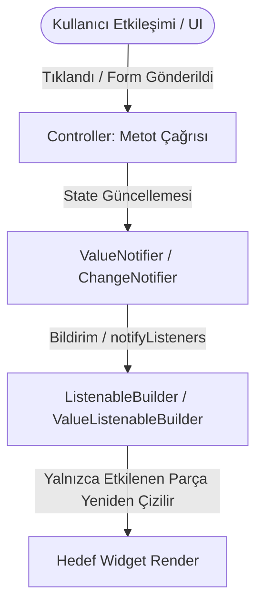

# Reaktif State Akışı (ValueNotifier & ListenableBuilder)

Bu belge `flutter-feature-scaffold` yeteneğindeki reaktif state akış prensiplerini belgeler.

## Temel Avantajlar
1. **İzole Yeniden Çizim:** Tüm sayfa (`setState`) yeniden çizilmez, sadece `ListenableBuilder` altındaki ağaç render edilir.
2. **Performans:** Değişmeyen dış bileşenler `const` olarak kalır.
3. **Temiz Ayrım:** Arayüz katmanı sadece gösterim yapar; iş mantığı controller içinde yaşar.
