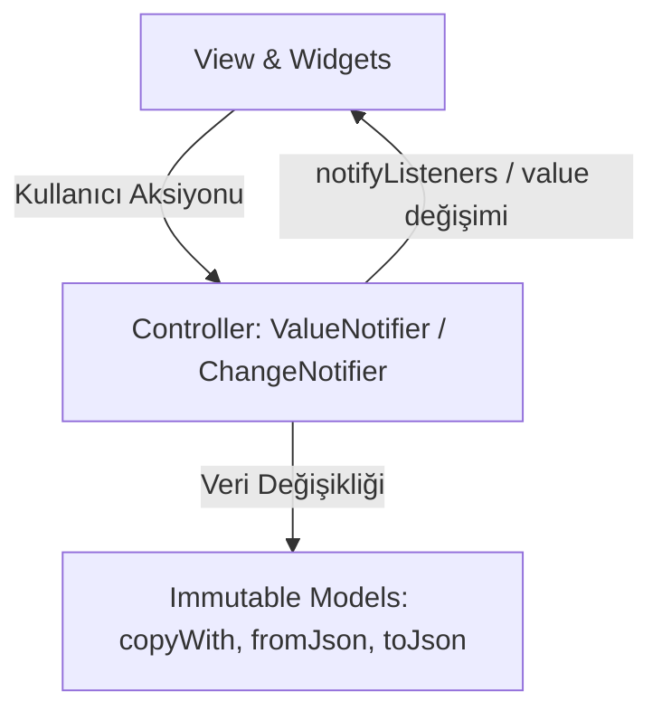

# Susadım v1 - Öğrenci ve Geliştirici Rehberi

Bu kılavuz, **Susadım v1** projesinin mimarisini, dosya yapısını, kullanılan tasarım kalıplarını ve her bir bileşenin hangi amaçla yazıldığını özetleyen pratik bir rehberdir.

---

## 🏗️ 1. Mimari Yaklaşım: Feature-First & Clean State

Projede kodlar tek bir dosyada veya katmanda toplanmaz. **Özellik bazlı (Feature-First)** yapı kullanılır.



### Neden Bu Mimari?
1. **Sorumlulukların Ayrılması (Separation of Concerns):** Arayüz sadece çizer, iş mantığını controller yürütür.
2. **Performans (İzole Render):** Sayfa düzeyinde ağır `setState` yerine sadece değişen alanı güncelleyen `ListenableBuilder` kullanılır.
3. **Test Edilebilirlik:** Ekranı açmadan controller ve modelleri %100 birim testleriyle doğrulayabilirsin.

---

## 📂 2. Dosya Haritası ve Görevleri

### 🔹 Core Katmanı (`lib/core/`)
Uygulamanın tüm modülleri tarafından paylaşılan çekirdek yapı taşlarıdır:
* [app_colors.dart](file:///Users/d1-18/Desktop/softito-mobil-app-developer-yuzyuze/19_ekim_2/lib/core/constants/app_colors.dart): Koyu (*Dark Obsidian & Neon*) ve Açık (*Clean Slate*) temaların renk paletlerini sabit tutar. Renkler doğrudan widget içine yazılmaz.
* [app_theme.dart](file:///Users/d1-18/Desktop/softito-mobil-app-developer-yuzyuze/19_ekim_2/lib/core/theme/app_theme.dart): Material 3 standardında `darkTheme` ve `lightTheme` tanımlarını içerir. Tipografi, kart ve buton stilleri burada merkezileştirilir.
* [theme_controller.dart](file:///Users/d1-18/Desktop/softito-mobil-app-developer-yuzyuze/19_ekim_2/lib/core/theme/theme_controller.dart): Koyu ve açık tema durumunu yönetir. Tek dokunuşla (`toggleTheme()`) reaktif geçiş sağlar.
* [context_extensions.dart](file:///Users/d1-18/Desktop/softito-mobil-app-developer-yuzyuze/19_ekim_2/lib/core/extensions/context_extensions.dart): `context.textTheme`, `context.colors` gibi tema ve boyut kısayollarını sunarak kod tekrarını önler.

---

### 🔹 Çoklu İçecek ve Hidrasyon Modülü (`features/beverage_tracker/`)
Su, çay, kahve ve maden suyu tüketimini hidrasyon çarpanlarına göre hesaplar:
* [models/beverage_type.dart](file:///Users/d1-18/Desktop/softito-mobil-app-developer-yuzyuze/19_ekim_2/lib/features/beverage_tracker/models/beverage_type.dart): İçecek türlerini, ikonlarını, neon renklerini, hidrasyon faktörlerini (Su: %100, Maden Suyu: %100, Çay: %90, Kahve: %80) ve hızlı porsiyon presetlerini saklar.
* [models/beverage_log_model.dart](file:///Users/d1-18/Desktop/softito-mobil-app-developer-yuzyuze/19_ekim_2/lib/features/beverage_tracker/models/beverage_log_model.dart): Tüketim kaydını tutan immutable model. Efektif hidrasyonu (`amountMl * factor`) hesaplar; `copyWith`, `fromJson` ve `toJson` metotlarına sahiptir.
* [controller/beverage_tracker_controller.dart](file:///Users/d1-18/Desktop/softito-mobil-app-developer-yuzyuze/19_ekim_2/lib/features/beverage_tracker/controller/beverage_tracker_controller.dart): Sıvı ekleme/silme, toplam hidrasyon, kalan miktar, günlük hedef ve içecek türüne göre dağılım mantığını yönetir.
* [widget/beverage_type_selector.dart](file:///Users/d1-18/Desktop/softito-mobil-app-developer-yuzyuze/19_ekim_2/lib/features/beverage_tracker/widget/beverage_type_selector.dart): İçecek türünü seçmeye yarayan yatay çip listesi.
* [widget/quick_beverage_buttons.dart](file:///Users/d1-18/Desktop/softito-mobil-app-developer-yuzyuze/19_ekim_2/lib/features/beverage_tracker/widget/quick_beverage_buttons.dart): Seçili içeceğe özel porsiyon butonları (İnce belli çay, espresso, matara vb.).
* [widget/beverage_breakdown_card.dart](file:///Users/d1-18/Desktop/softito-mobil-app-developer-yuzyuze/19_ekim_2/lib/features/beverage_tracker/widget/beverage_breakdown_card.dart): Hangi içecekten kaç ml tüketildiğini özetleyen analitik kartı.
* [widget/beverage_log_history_list.dart](file:///Users/d1-18/Desktop/softito-mobil-app-developer-yuzyuze/19_ekim_2/lib/features/beverage_tracker/widget/beverage_log_history_list.dart): Günlük tüketim geçmişini zaman damgası ve silme aksiyonuyla listeleyen bileşen.
* [view/beverage_tracker_view.dart](file:///Users/d1-18/Desktop/softito-mobil-app-developer-yuzyuze/19_ekim_2/lib/features/beverage_tracker/view/beverage_tracker_view.dart): Tüm içecek widget'larını bir araya getiren ana ekran.

---

### 🔹 Su Takip Modülü ve Geriye Dönük Uyumluluk (`features/water_tracker/`)
Eski sürümlerden gelen kodların ve testlerin kırılmaması için kurulmuş köprü katmandır:
* [models/water_log_model.dart](file:///Users/d1-18/Desktop/softito-mobil-app-developer-yuzyuze/19_ekim_2/lib/features/water_tracker/models/water_log_model.dart): `typedef WaterLogModel = BeverageLogModel` tanımlayarak eski veri tiplerini korur.
* [controller/water_tracker_controller.dart](file:///Users/d1-18/Desktop/softito-mobil-app-developer-yuzyuze/19_ekim_2/lib/features/water_tracker/controller/water_tracker_controller.dart): `BeverageTrackerController`'ı miras alarak eski su metotlarını (`addWater`) sorunsuz sürdürür.
* [widget/water_progress_indicator.dart](file:///Users/d1-18/Desktop/softito-mobil-app-developer-yuzyuze/19_ekim_2/lib/features/water_tracker/widget/water_progress_indicator.dart): Neon dairesel ilerleme halkası.
* [widget/water_tracker_card.dart](file:///Users/d1-18/Desktop/softito-mobil-app-developer-yuzyuze/19_ekim_2/lib/features/water_tracker/widget/water_tracker_card.dart): `SKILL.md` yönergesindeki modüler kart örneğine uygun arayüz widget'ı.

---

### 🔹 Egzersiz ve Kalori Modülü (`features/workout/`)
Fitness antrenmanlarını ve yakılan kalorileri takip eder:
* [models/workout_model.dart](file:///Users/d1-18/Desktop/softito-mobil-app-developer-yuzyuze/19_ekim_2/lib/features/workout/models/workout_model.dart): Antrenman türü (Kardiyo, Ağırlık, HIIT, Bisiklet, Yüzme) ve süre/kalori verisini tutar.
* [controller/workout_controller.dart](file:///Users/d1-18/Desktop/softito-mobil-app-developer-yuzyuze/19_ekim_2/lib/features/workout/controller/workout_controller.dart): Toplam süre, yakılan kalori ve günlük kalori hedefi oranını hesaplar.
* [widget/workout_summary_card.dart](file:///Users/d1-18/Desktop/softito-mobil-app-developer-yuzyuze/19_ekim_2/lib/features/workout/widget/workout_summary_card.dart): Neon lime aydınlatmalı günlük kalori ve hedef çubuğu kartı.
* [widget/add_workout_modal.dart](file:///Users/d1-18/Desktop/softito-mobil-app-developer-yuzyuze/19_ekim_2/lib/features/workout/widget/add_workout_modal.dart): Kullanıcının tür ve süre seçerek yeni egzersiz eklemesini sağlayan alt sayfa (bottom sheet).
* [view/workout_view.dart](file:///Users/d1-18/Desktop/softito-mobil-app-developer-yuzyuze/19_ekim_2/lib/features/workout/view/workout_view.dart): Antrenman takip ana ekranı.

---

### 🔹 Uygulama İskeleti ve Giriş
* [features/splash/splash_screen.dart](file:///Users/d1-18/Desktop/softito-mobil-app-developer-yuzyuze/19_ekim_2/lib/features/splash/splash_screen.dart): Logo animasyonu ile açılan, 2.2 saniye sonra ana menüye yönlendiren açılış sayfası.
* [features/dashboard/dashboard_shell.dart](file:///Users/d1-18/Desktop/softito-mobil-app-developer-yuzyuze/19_ekim_2/lib/features/dashboard/dashboard_shell.dart): Alt navigasyon menüsü (`NavigationBar`) ile 'İçecek & Su' ve 'Antrenman' sekmelerini yöneten kabuk.
* [main.dart](file:///Users/d1-18/Desktop/softito-mobil-app-developer-yuzyuze/19_ekim_2/lib/main.dart): Controller'ları başlatan, temaları sağlayan ve uygulamayı ayağa kaldıran kök dosya.

---

## 🎯 3. Altın Kurallar (Neyi Neden Yapıyoruz?)

1. **Neden `const` Kullanıyoruz?**
   - Flutter'da `const` olan widget'lar bir kere oluşturulur ve bellekten tekrar tekrar türetilmez. Bu, uygulamanın 60-120 FPS akıcılıkta kalmasını sağlar.
2. **Neden Build Metodu ≤ 40 Satır?**
   - Tek bir `build` metodunda yüzlerce satır arayüz yazmak okunabilirliği öldürür ve hata bulmayı zorlaştırır. Parçala ve yönet prensibiyle küçük widget dosyalarına bölünür.
3. **Neden Ağır Paketler (GetX, Bloc vb.) Eklenmedi?**
   - `project.md` kuralları gereği harici paket bağımlılığını azaltmak, uygulamanın boyutunu küçük tutmak ve Flutter'ın yerel gücünü (`ChangeNotifier`, `ValueNotifier`) en temiz şekilde öğrenmek için tercih edilmiştir.
4. **Karanlık / Aydınlık Mod Nasıl Çalışır?**
   - `ThemeController` içinde tutulan durum değiştiğinde, `main.dart`'taki `ListenableBuilder` tetiklenir ve `MaterialApp`'in `themeMode` parametresini günceller. Renkler tema dosyalarından dinamik olarak çekilir.

---

## 🧪 4. Doğrulama ve Test Komutları

Projede yaptığın geliştirmeleri terminalde şu iki komutla hızlıca test edebilirsin:

```bash
# 1. Kod analizinde 0 hata ve 0 uyarı olduğunu doğrulamak için:
flutter analyze

# 2. Tüm birim ve widget testlerini çalıştırmak için:
flutter test
```
