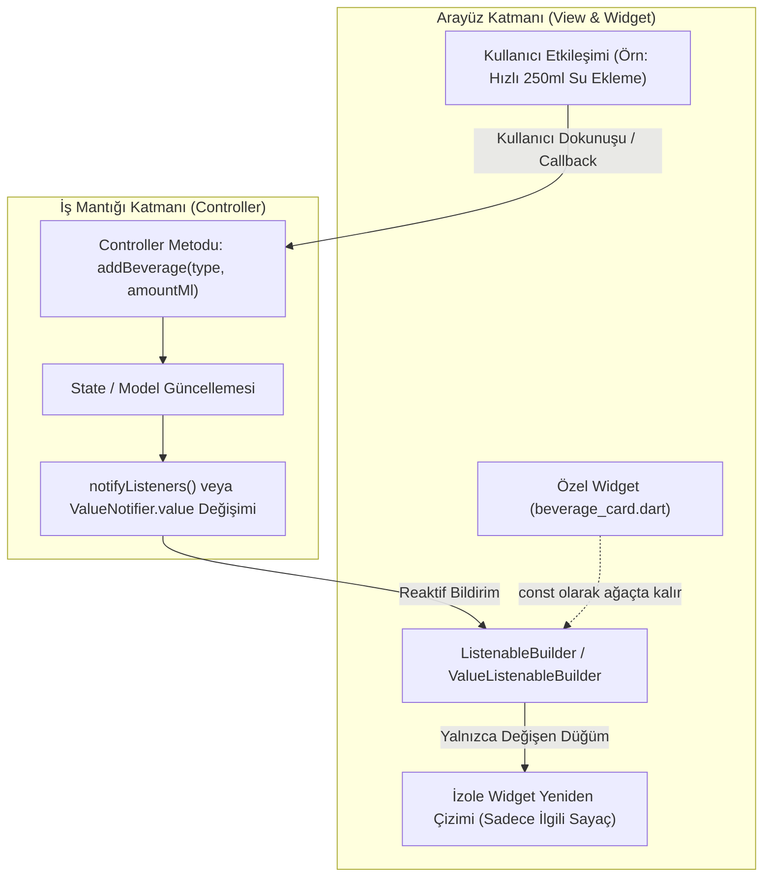
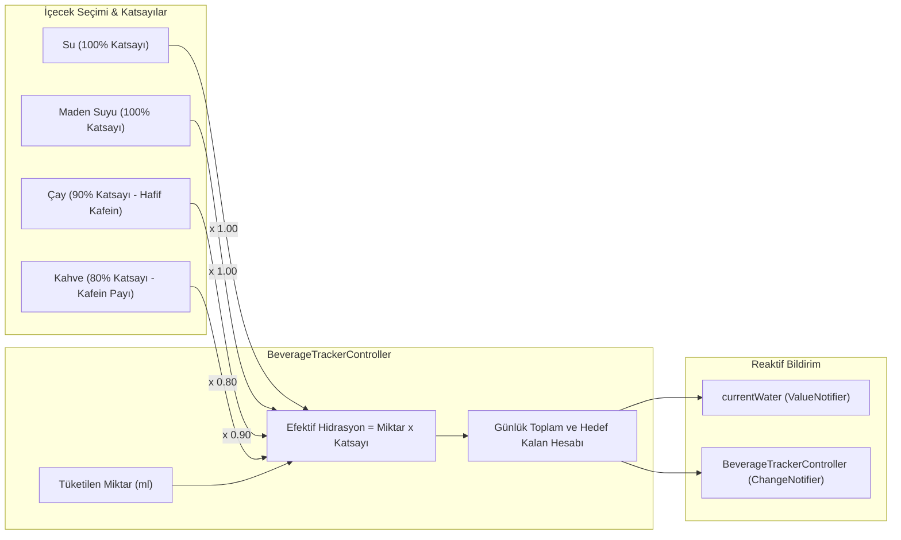

# Reaktif State Akışı ve Mimari Prensipleri (ValueNotifier & ListenableBuilder)

Bu belge, `flutter-feature-scaffold` yeteneği ve **Susadım (Fitness Su ve İçecek Takip)** projesinin mimari standartları doğrultusunda reaktif state yönetim akışını, çoklu içecek hidrasyon döngüsünü ve katmanlar arası sorumluluk dağılımını belgeler.

---

## 1. Genel Reaktif State Akış Döngüsü

Uygulamada sayfa düzeyinde `setState` kullanımı kesinlikle yasaktır. State akışı, Flutter'ın çekirdek reaktif sınıfları (`ValueNotifier`, `ChangeNotifier` ve `ListenableBuilder`) üzerinden tek yönlü veri akışı (unidirectional data flow) prensibine göre işler.



---

## 2. Çoklu İçecek ve Efektif Hidrasyon Akışı

`project.md` 6. maddesi uyarınca desteklenen içeceklerin hidrasyon katsayıları ve akışı aşağıda gösterilmiştir:



---

## 3. Özellik Bazlı MVC (Feature-Based MVC) Katmanları ve Sorumluluk Dağılımı

Her özellik (`feature`) kesinlikle MVC prensiplerine uygun olarak 4 ana klasör altında yapılandırılır:

| MVC Katmanı | Konum | Sorumluluk | Kural & Kısıtlamalar |
| :--- | :--- | :--- | :--- |
| **Model (M)** | `models/` | Domain entity, veri yapıları ve serileştirme | `immutable`, tüm alanlar `final`, `const` constructor, `copyWith`, `fromJson`, `toJson`. UI ve Controller bağımlılığı YASAKTIR. |
| **Controller (C)** | `controller/` | Durum saklama, iş mantığı, hidrasyon hesaplamaları | `ChangeNotifier` / `ValueNotifier` kullanır. Veri değişiminde `notifyListeners()` çağırır. `dispose()` ile kaynakları serbest bırakır. |
| **View (V)** | `view/` | Sayfa iskeleti, layout organizasyonu | `StatelessWidget` olmalıdır. Controller'ı dinler (`ListenableBuilder`). Sayfa düzeyinde `setState` YASAKTIR. |
| **Sub-Views / Widget (V)** | `widget/` | Tekrar kullanılabilir, modüler UI bileşenleri | Build metodu 40 satırı geçemez. Mümkün olan her yerde `const` zorunludur. |

### MVC Veri ve Kontrol Prensibi
1. **Model** asla View'i veya Controller'ı bilmez (tamamen bağımsız ve saf Dart nesnesi).
2. **View** yalnızca Controller'ı dinler ve tetikler; doğrudan iş mantığı veya veri mutasyonu yapamaz.
3. **Controller** Model listelerini/nesnelerini yönetir, aksiyonları işletir ve View'i `notifyListeners` veya `ValueNotifier` aracılığıyla reaktif olarak günceller.

---

## 4. Kırmızı Çizgiler ve Kod Kalitesi Kuralları

1. **Sayfa Düzeyinde Ağır `setState` Yasağı:**
   - Sayfa genelinde render tetikleyen `setState` kullanılamaz.
   - Sadece yerel animasyon ve micro-etkileşimler için lokal `StatefulWidget` kabul edilir.
2. **40 Satır Build Metodu Kuralı:**
   - 40 satırı geçen `build` metodları kesinlikle alt widget'lara parçalanarak `widget/` altına taşınmalıdır.
3. **`const` Constructor Zorunluluğu:**
   - Durumu değişmeyen tüm widget'lar, sabit renkler ve metin stilleri `const` ile tanımlanmalıdır.
4. **Yasaklı Paketler:**
   - İzin alınmadan harici ağır state paketleri (`bloc`, `flutter_bloc`, `riverpod`, `mobx`) projeye eklenemez.
   - Flutter çekirdek API'leri (`ValueNotifier`, `ChangeNotifier`, `ListenableBuilder`, `ValueListenableBuilder`) esastır.
5. **Geriye Dönük Uyumluluk (Backward Compatibility):**
   - Eski `WaterTrackerController` ve `WaterLogModel` arabirimleri korunmalı, `BeverageTrackerController` altında uyumlu olarak çalışmalıdır.
6. **Bellek Sızıntısı (Memory Leak) Koruması:**
   - Oluşturulan her `ValueNotifier` veya `ChangeNotifier`, yaşam döngüsü sonunda `dispose()` edilmelidir.

---

## 5. Doğrulama ve Test Adımları

Geliştirilen her feature sonrasında terminalden aşağıdaki komutlar çalıştırılarak 0 uyarı ve 0 hata elde edilmelidir:

```bash
# 1. Statik Kod Analizi (0 hata / 0 uyarı şartı)
flutter analyze

# 2. Birim ve Widget Testleri
flutter test
```
