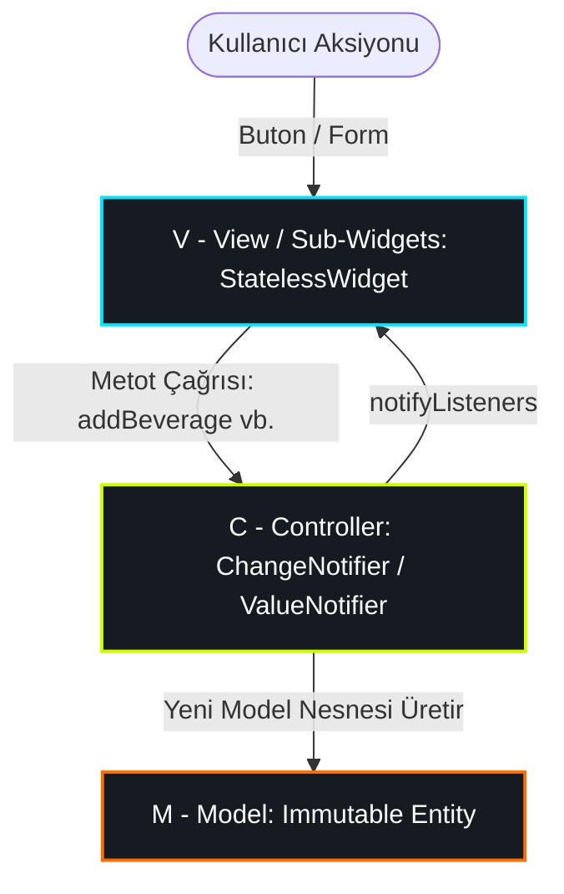

# Susadım v1 - Özellik Bazlı MVC (Feature-Based MVC) Öğrenci Rehberi

Bu kılavuz, **Susadım v1** projesinde uygulanan **Özellik Bazlı MVC (Feature-Based Model-View-Controller)** mimarisini, katmanların sorumluluklarını, her bir dosyanın görevini ve tasarım tercihlerinin amaçlarını özetleyen bir öğrenci rehberidir.

---

## 🏗️ 1. Mimari Yapı: Özellik Bazlı MVC (Feature-Based MVC)

Projede kodlar tek bir klasörde toplanmaz; her özellik (`beverage_tracker`, `workout`, `water_tracker`) kendi içinde bağımsız bir **MVC** üçgeni oluşturur.



### MVC Katman Sorumlulukları
1. **Model (M - `models/`):**
   - Saf veri yapılarıdır (Domain Entity).
   - Kesinlikle `immutable` (değişmez) olmalı, tüm alanlar `final` tanımlanmalı ve `const` constructor içermelidir.
   - `copyWith`, `fromJson` ve `toJson` metotlarına sahiptir.
   - Saf matematiksel hesaplamaları getter olarak sunar (örn: `effectiveHydrationMl = amountMl * factor`).
2. **View & Sub-Widgets (V - `view/` ve `widget/`):**
   - Pasif görsel katmandır (Passive View); doğrudan iş mantığı içermez.
   - `view/`: `StatelessWidget` olup `ListenableBuilder` ile Controller'ı dinler. Sayfa düzeyinde ağır `setState` kullanılmaz.
   - `widget/`: 40 satırı geçmeyen, `const` constructor destekli, tekrar kullanılabilir alt bileşenlerdir.
3. **Controller (C - `controller/`):**
   - View ile Model arasındaki köprüdür; iş mantığını ve reaktif durumu yönetir.
   - Flutter'ın yerel çekirdek API'lerini (`ChangeNotifier`, `ValueNotifier`) kullanır.
   - UI etkileşimlerini metotlarla karşılar, listeleri günceller, dinleyicileri uyarır (`notifyListeners()`) ve `dispose()` ile belleği temizler.

---

## 📂 2. Dosya Haritası ve Görevleri

### 🔹 Core Katmanı (`lib/core/`)
Tüm modüller tarafından ortaklaşa kullanılan çekirdek altyapı:
* [app_colors.dart](file:///Users/d1-18/Desktop/softito-mobil-app-developer-yuzyuze/19_ekim_3/lib/core/constants/app_colors.dart): Koyu (*Dark Obsidian & Neon*) ve Açık (*Clean Slate*) temaların renk sabitleri.
* [app_theme.dart](file:///Users/d1-18/Desktop/softito-mobil-app-developer-yuzyuze/19_ekim_3/lib/core/theme/app_theme.dart): Material 3 standardında `darkTheme` ve `lightTheme` yapılandırması.
* [theme_controller.dart](file:///Users/d1-18/Desktop/softito-mobil-app-developer-yuzyuze/19_ekim_3/lib/core/theme/theme_controller.dart): `ThemeMode.dark` ve `ThemeMode.light` geçişini yöneten reaktif kontrolcü.
* [context_extensions.dart](file:///Users/d1-18/Desktop/softito-mobil-app-developer-yuzyuze/19_ekim_3/lib/core/extensions/context_extensions.dart): `context.textTheme`, `context.colors` gibi tema ve boyut kısayolları.

---

### 🔹 Çoklu İçecek ve Hidrasyon Modülü (`features/beverage_tracker/`)
* **Model (M):**
  * [beverage_type.dart](file:///Users/d1-18/Desktop/softito-mobil-app-developer-yuzyuze/19_ekim_3/lib/features/beverage_tracker/models/beverage_type.dart): İçecek türleri, ikonlar, neon renkler ve hidrasyon katsayıları (Su: %100, Maden Suyu: %100, Çay: %90, Kahve: %80).
  * [beverage_log_model.dart](file:///Users/d1-18/Desktop/softito-mobil-app-developer-yuzyuze/19_ekim_3/lib/features/beverage_tracker/models/beverage_log_model.dart): Tüketim kaydını tutan immutable model (`copyWith`, `fromJson`, `toJson`).
* **Controller (C):**
  * [beverage_tracker_controller.dart](file:///Users/d1-18/Desktop/softito-mobil-app-developer-yuzyuze/19_ekim_3/lib/features/beverage_tracker/controller/beverage_tracker_controller.dart): Sıvı ekleme/silme, toplam hidrasyon, kalan miktar, günlük hedef ve sıvı dağılım grafiğini yöneten `ChangeNotifier` / `ValueNotifier` sınıfı.
* **View (V):**
  * [beverage_tracker_view.dart](file:///Users/d1-18/Desktop/softito-mobil-app-developer-yuzyuze/19_ekim_3/lib/features/beverage_tracker/view/beverage_tracker_view.dart): Alt bileşenleri bir araya getiren ana ekran iskeleti.
* **Sub-Widgets (V):**
  * [beverage_type_selector.dart](file:///Users/d1-18/Desktop/softito-mobil-app-developer-yuzyuze/19_ekim_3/lib/features/beverage_tracker/widget/beverage_type_selector.dart): İçecek seçme çipleri.
  * [quick_beverage_buttons.dart](file:///Users/d1-18/Desktop/softito-mobil-app-developer-yuzyuze/19_ekim_3/lib/features/beverage_tracker/widget/quick_beverage_buttons.dart): İçeceğe özel hızlı porsiyon butonları.
  * [beverage_breakdown_card.dart](file:///Users/d1-18/Desktop/softito-mobil-app-developer-yuzyuze/19_ekim_3/lib/features/beverage_tracker/widget/beverage_breakdown_card.dart): Tüketilen sıvı dağılımını gösteren kart.
  * [beverage_log_history_list.dart](file:///Users/d1-18/Desktop/softito-mobil-app-developer-yuzyuze/19_ekim_3/lib/features/beverage_tracker/widget/beverage_log_history_list.dart): Zaman damgalı tüketim geçmişi.

---

### 🔹 Su Takip Köprüsü (`features/water_tracker/` - Geriye Dönük Uyumluluk)
* [water_log_model.dart](file:///Users/d1-18/Desktop/softito-mobil-app-developer-yuzyuze/19_ekim_3/lib/features/water_tracker/models/water_log_model.dart): `WaterLogModel = BeverageLogModel` typedef köprüsü.
* [water_tracker_controller.dart](file:///Users/d1-18/Desktop/softito-mobil-app-developer-yuzyuze/19_ekim_3/lib/features/water_tracker/controller/water_tracker_controller.dart): `BeverageTrackerController` sınıfını extend eden geriye dönük uyumlu kontrolcü.
* [water_progress_indicator.dart](file:///Users/d1-18/Desktop/softito-mobil-app-developer-yuzyuze/19_ekim_3/lib/features/water_tracker/widget/water_progress_indicator.dart): Neon halka ilerleme göstergesi.
* [water_tracker_card.dart](file:///Users/d1-18/Desktop/softito-mobil-app-developer-yuzyuze/19_ekim_3/lib/features/water_tracker/widget/water_tracker_card.dart): SKILL yönergesine uygun modüler kart.

---

### 🔹 Egzersiz ve Kalori Modülü (`features/workout/`)
* **Model (M):** [workout_model.dart](file:///Users/d1-18/Desktop/softito-mobil-app-developer-yuzyuze/19_ekim_3/lib/features/workout/models/workout_model.dart) (Kardiyo, Ağırlık, HIIT, Bisiklet, Yüzme ve kalori katsayıları).
* **Controller (C):** [workout_controller.dart](file:///Users/d1-18/Desktop/softito-mobil-app-developer-yuzyuze/19_ekim_3/lib/features/workout/controller/workout_controller.dart) (Kalori hedefi, egzersiz kayıtları, süre ve yakılan kalori hesabı).
* **View (V):** [workout_view.dart](file:///Users/d1-18/Desktop/softito-mobil-app-developer-yuzyuze/19_ekim_3/lib/features/workout/view/workout_view.dart) (Antrenman ana ekranı).
* **Sub-Widgets (V):** [workout_summary_card.dart](file:///Users/d1-18/Desktop/softito-mobil-app-developer-yuzyuze/19_ekim_3/lib/features/workout/widget/workout_summary_card.dart), [workout_list_item.dart](file:///Users/d1-18/Desktop/softito-mobil-app-developer-yuzyuze/19_ekim_3/lib/features/workout/widget/workout_list_item.dart), [add_workout_modal.dart](file:///Users/d1-18/Desktop/softito-mobil-app-developer-yuzyuze/19_ekim_3/lib/features/workout/widget/add_workout_modal.dart).

---

### 🔹 Uygulama İskeleti
* [dashboard_shell.dart](file:///Users/d1-18/Desktop/softito-mobil-app-developer-yuzyuze/19_ekim_3/lib/features/dashboard/dashboard_shell.dart): Alt menü (`NavigationBar`) ile modüller arası geçiş sağlayan `IndexedStack` kabuğu.
* [splash_screen.dart](file:///Users/d1-18/Desktop/softito-mobil-app-developer-yuzyuze/19_ekim_3/lib/features/splash/splash_screen.dart): Neon logolu ve açılış animasyonlu giriş ekranı.
* [main.dart](file:///Users/d1-18/Desktop/softito-mobil-app-developer-yuzyuze/19_ekim_3/lib/main.dart): Uygulama giriş noktası, Controller'ların oluşturulması ve tema konfigürasyonu.

---

## 🎯 3. Altın Kurallar ve Amaçları

1. **Neden Model Immutable Olmalı?**
   - Değerlerin beklenmedik yerlerde referans yoluyla değişmesini engeller. Durum sadece Controller üzerinden kontrollü üretilir (`copyWith`).
2. **Neden `ListenableBuilder`?**
   - Sayfanın tamamının (`setState`) gereksiz yere baştan çizilmesini önler; sadece değeri değişen widget alt ağacı izole olarak render edilir (60+ FPS akıcılık).
3. **Neden Build Metodu ≤ 40 Satır?**
   - Tek bir `build` metodunun uzaması okunabilirliği ve bakım yapılabilirliği zorlaştırır; parçalara ayırmak kodun yeniden kullanılabilirliğini (reusability) artırır.
4. **Neden Ağır Paketler Yasak?**
   - Harici paket bağımlılığı mimariyi kırılganlaştırır ve uygulama boyutunu şişirir. Flutter'ın yerel API'leri en performanslı çözümü sunar.

---

## 🧪 4. Doğrulama ve Test Adımları

```bash
# 1. Kod analizinde 0 hata ve 0 uyarı doğrulaması:
flutter analyze

# 2. Tüm birim ve widget testlerini çalıştırmak için:
flutter test
```
