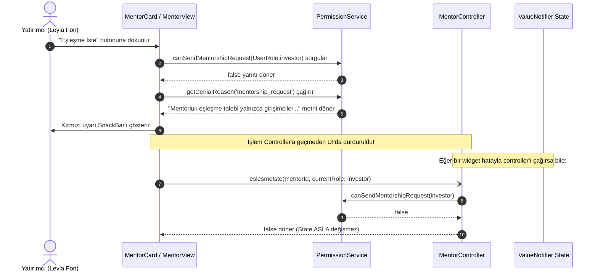

# 🚀 Yörünge Girişimcilik Platformu — Kapsamlı Öğrenci Rehberi

> **Merhaba Genç Geliştirici!** 👋  
> Flutter dünyasına hoş geldin! Bu rehber, Flutter ve Dart öğrenme yolculuğunda senin için bir deniz feneri olması amacıyla hazırlandı.  
> Bu projede basit bir "Merhaba Dünya" veya geçici bir ödev yerine; kurumsal şirketlerde, start-up'larda ve büyük ölçekli mobil uygulamalarda kullanılan **en temiz mimariyi (Clean Architecture & Feature-First)**, **yerel durum yönetimini (State Management)** ve **tasarım sistemi (Design System)** disiplinini baştan sona inceleyeceğiz.

---

## 📑 İçindekiler
1. [Projenin Amacı ve Vizyonu](#1-projenin-amacı-ve-vizyonu)
2. [Mimariyi Anlamak: Feature-First Yaklaşımı](#2-mimariyi-anlamak-feature-first-yaklaşımı)
3. [Klasör Ağacı ve Dosyaların Sorumlulukları](#3-klasör-ağacı-ve-dosyaların-sorumlulukları)
4. [Durum Yönetimi (State Management): Neden ValueNotifier?](#4-durum-yönetimi-state-management-neden-valuenotifier)
5. [Tasarım Sistemi ve Tema Mimarisi](#5-tasarım-sistemi-ve-tema-mimarisi)
6. [İleri Düzey Flutter Konuları: Neyi, Nerede, Neden Kullandık?](#6-ileri-düzey-flutter-konuları-neyi-nerede-neden-kullandık)
7. [Önemli Özelliklerin Derinlemesine İncelemesi](#7-önemli-özelliklerin-derinlemesine-incelemesi)
8. [Temiz Kod Standartları ve Birim Testleri](#8-temiz-kod-standartları-ve-birim-testleri)
9. [Kendini Geliştirmen İçin 5 Pratik Alıştırma](#9-kendini-geliştirmen-için-5-pratik-alıştırma)
10. [Kimlik Doğrulama, Kayıt ve Demo Oturum Mimarisi (Öğrenci Kılavuzu)](#10-kimlik-doğrulama-kayıt-ve-demo-oturum-mimarisi-öğrenci-kılavuzu)

---

## 1. Projenin Amacı ve Vizyonu

**Yörünge**, girişimcileri fikir aşamasından şirketleşme sürecine kadar destekleyen; onları **mentorlar**, **yatırımcılar**, **destek programları** ve **diğer kurucularla** buluşturan uçtan uca bir mobil platformdur.

* **Uzay ve Yörünge Metaforu:** Bir fikrin tohumdan filizlenip yükselmesi, bir roketin fırlatılıp yörüngeye oturmasına benzetilmiştir. Görsel dilde derin uzay siyahı (`#05070F`), gece mavisi, roket ateşi turuncusu (`#FF6B2C`) ve nebula camgöbeği (`#22D3EE`) kullanılmıştır.
* **Gerçek Dünya Disiplini:** Projede harici karmaşık paket yığınları (Bloc, Riverpod, GetX) kullanılmamış; Flutter'ın kendi saf gücü (`ValueNotifier`, `CustomPainter`, `ThemeExtension`, `InheritedWidget`) ile maksimum performans ve sıfır bellek sızıntısı hedeflenmiştir.

---

## 2. Mimariyi Anlamak: Feature-First Yaklaşımı

Flutter öğrenmeye başlayanların yaptığı en büyük hata, tüm dosyaları `screens/`, `widgets/`, `models/` adında üç devasa klasöre doldurmaktır. Uygulama büyüdükçe (10-20 ekrana ulaştığında) hangi modelin hangi ekranla ilişkili olduğu kaybolur ("Spaghetti Code").

Yörünge projesinde **Feature-First (Özellik Odaklı)** mimari kullandık:

```text
features/
  ├── mentor/          <-- Mentor modülü kendi dünyasında yaşar
  ├── yatirimci/       <-- Yatırımcı modülü tamamen izoledir
  ├── programlar/      <-- Destek programları modülü
  ├── topluluk/        <-- Mikro-blog topluluk akışı
  ├── analiz/          <-- 8 Adımlı iş planı stepper formu
  ├── fikir_durumu/    <-- 6 Aşamalı şirketleşme yol haritası
  ├── shell/           <-- Ana iskelet ve 4 sekmeli alt bar
  └── splash/          <-- Açılış animasyon ekranı
```

### 5 Katman Kuralı (Her Feature İçin)
Her özelliğin içinde kodlar 5 kesin katmana ayrılır:
1. **`models/` (Veri Tipleri):** Sadece verinin şeklini tanımlar (`final` alanlar, `const` constructor). UI veya Flutter widget kodu içermez.
2. **`data/` (Veri Kaynağı):** Mock verileri veya yerel depolama/API kaynaklarını barındırır. Ekran kodları asla veriyi kendi içinde üretmez.
3. **`controller/` (İş Mantığı - Logic):** Filtreleme, arama, durum değiştirme işlemlerini yönetir. **Kesin kural:** Controller içinde `BuildContext`, `Navigator` veya UI widget'ı bulunmaz! Tamamen saf Dart sınıflarıdır.
4. **`widget/` (Küçük Parçalar):** Yalnızca o özelliğe ait tekrar kullanılabilir UI bileşenleri (örn: `MentorCard`, `InvestorCard`).
5. **`view/` (Sayfa İskeleti):** Widget'ları ve controller'ı bir araya getiren ana ekran (örn: `MentorView`).

---

## 3. Klasör Ağacı ve Dosyaların Sorumlulukları

```text
lib/
├── main.dart                          <-- Uygulamanın giriş noktası (main fonksiyonu)
├── core/                              <-- Tüm uygulamada ortak kullanılan çekirdek katman
│   ├── constants/
│   │   ├── app_colors.dart            <-- Renk token'ları (Derin Uzay & Şafak Fırlatışı)
│   │   ├── app_spacing.dart           <-- 4px grid sistemine dayalı boşluklar & radius
│   │   └── app_strings.dart           <-- Merkezi metinler ve buton etiketleri
│   ├── extensions/
│   │   └── context_extensions.dart    <-- context.spaceColors ve context.textTheme
│   ├── theme/
│   │   ├── app_theme.dart             <-- Material 3 Dark ve Light ThemeData tanımları
│   │   └── theme_controller.dart      <-- Tema değiştirme ve SharedPreferences kaydı
│   └── widgets/
│       ├── glow_card.dart             <-- Parlama efektli katmanlı kart bileşeni
│       ├── starfield_background.dart  <-- CustomPainter ile yıldızlı derin uzay fonu
│       ├── section_header.dart        <-- Standart hiyerarşik bölüm başlıkları
│       └── yorunge_logo.dart          <-- Matematiksel orbital dönen vektör logo
└── features/                          <-- Özellik modülleri (mentor, topluluk vs.)
```

> [!TIP]
> **Öğrenci Kuralı:** Eğer bir bileşen veya fonksiyon yalnızca TEK BİR ekranda kullanılıyorsa o özelliğin `widget/` veya `controller/` klasörüne konur. Eğer EN AZ İKİ FARKLI modül tarafından ortak kullanılıyorsa `core/` katmanına taşınır.

---

## 4. Durum Yönetimi (State Management): Neden ValueNotifier?

Yeni başlayanlar genellikle "State management için ne öğrenmeliyim? Bloc mu, Riverpod mu, GetX mi?" ikilemine düşer.  
Oysa Flutter'ın kendi çekirdeğinde harika bir araç vardır: **`ValueNotifier<T>` ve `ValueListenableBuilder<T>`**.

### `setState` Neden Yetersiz Kalır?
Bir sayfada `setState(() {})` çağırdığında Flutter tüm ekran ağacını (AppBar, filtreler, listeler, kartlar) baştan aşağı yeniden çizer (`build` fonksiyonu tekrar çalışır). Bu hem cihazın pilini tüketir hem de 120 FPS akıcılığı bozar.

### `ValueNotifier` Nasıl Çalışır?
1. Controller içinde bir değişkeni kutuya sararız:
   ```dart
   final ValueNotifier<String?> seciliSektor = ValueNotifier<String?>(null);
   ```
2. Değer değiştiğinde sadece dinleyicileri uyarırız:
   ```dart
   void sektorSec(String? sektor) {
     seciliSektor.value = sektor; // <-- Sadece dinleyen widget'lar uyanır!
   }
   ```
3. Arayüzde yalnızca güncellenmesi gereken minik parçayı sararız:
   ```dart
   ValueListenableBuilder<String?>(
     valueListenable: controller.seciliSektor,
     builder: (context, secili, child) {
       return Text(secili ?? 'Tüm Sektörler');
     },
   )
   ```
Böylece ekrandaki diğer 50 widget hiç etkilenmeden sadece o metin anında güncellenir!

---

## 5. Tasarım Sistemi ve Tema Mimarisi

Gelişmiş bir Flutter uygulamasında kodun içine asla sabit renk (`Color(0xFF05070F)`) veya sabit yazı stili (`TextStyle(fontSize: 16)`) yazılmaz.

### Token ve `ThemeExtension` Mantığı
`core/constants/app_colors.dart` içinde bir `ThemeExtension` yazdık:
```dart
@immutable
class SpaceColors extends ThemeExtension<SpaceColors> {
  final Color background;
  final Color surface;
  final Color rocketFlame; // Ana aksiyon rengi (#FF6B2C)
  final Color nebulaCyan;  // İkincil vurgu (#22D3EE)
  // ...
}
```
Ve `core/extensions/context_extensions.dart` sayesinde kodun herhangi bir yerinde tek satırla temaya uygun renge erişebilirsin:
```dart
Container(
  color: context.spaceColors.background, // Karanlıkta siyah, aydınlıkta beyaz olur!
)
```
Kullanıcı sağ üstteki Güneş/Ay ikonuna dokunduğunda tüm uygulama baştan aşağı renk değiştirir ama senin tek bir satır kod değiştirmen gerekmez!

---

## 6. İleri Düzey Flutter Konuları: Neyi, Nerede, Neden Kullandık?

### 1. `CustomPainter` ile Yıldızlı Uzay (`starfield_background.dart`)
* **Neden?** Yüksek çözünürlüklü bir uzay fotoğrafı kullanmak uygulamanın megabayt boyutunu artırır ve RAM tüketir.
* **Nasıl?** `CustomPainter` kullanarak ekran piksel boyutuna göre matematiksel (`math.Random`) olarak mini yıldız noktacıkları çizdik.
* **Önemli Optimizasyon:** Her ekran kaydırıldığında yıldızlar tekrar tekrar hesaplanmasın diye `RepaintBoundary` ve deterministik tohum (seed) kullandık.

### 2. `IndexedStack` ile Sekme Durumunu Koruma (`shell_view.dart`)
* **Neden?** Kullanıcı "Mentorlar" sekmesinde arama yapıp 5. sıraya kadar kaydırdıktan sonra "Yatırımcılar" sekmesine geçer ve geri dönerse kaydırma konumu kaybolmamalıdır.
* **Nasıl?** `IndexedStack` tüm 4 sayfayı hafızada canlı tutar ve sadece seçili olanı görünür kılar.

### 3. `CustomScrollView` ve `Slivers`
* **Neden?** Bir sayfada hem yatay kayan liste (`Öne Çıkan Mentorlar`), hem arama kutusu, hem de dikey liste varsa standart `SingleChildScrollView + ListView` kullanmak "Vertical viewport was given unbounded height" hatası verir veya performansı düşürür.
* **Nasıl?** `SliverToBoxAdapter` ve `SliverList` kullanarak sayfanın pürüzsüz ve tek bir akıcı kaydırma (scroll) ile çalışmasını sağladık.

### 4. `SharedPreferences` ile Yerel Kalıcılık
* `ThemeController`: Kullanıcının seçtiği koyu/açık tema telefon yeniden başlatılsa bile hatırlanır.
* `AnalysisController`: 8 adımlı iş planı formunu doldururken kullanıcı uygulamayı kapatsa bile yazdığı tüm taslak geri yüklenir.

### 5. Açılış Ekranı (Splash Screen) ve Mikro Animasyonlar (`splash_screen.dart`)
* `AnimationController` ile `CurvedAnimation` (Curves.easeOutBack) birleştirildi.
* `ShaderMask` ile "Y Ö R Ü N G E" metnine uzay gradyanı giydirildi.
* `Timer` ile 2.4 saniye sonra `PageRouteBuilder` kullanılarak yumuşak bir saydamlık geçişi (`FadeTransition`) ile ana ekrana geçildi.

---

## 7. Önemli Özelliklerin Derinlemesine İncelemesi

### 🔍 Arama ve Türkçe Karakter Normalizasyonu
Kullanıcılar Türkçe klavyede bazen `yapay zeka`, bazen `yapay zekâ` yazabilir; ya da `i` yerine `ı` kullanabilir.
`MentorController` ve `YatirimciController` içine özel bir `normalize()` motoru yazdık:
```dart
static String normalize(String text) {
  return text
      .toLowerCase()
      .replaceAll('â', 'a')
      .replaceAll('ı', 'i')
      .replaceAll('İ', 'i')
      .replaceAll('ğ', 'g')
      .replaceAll('ü', 'u')
      .replaceAll('ş', 's')
      .replaceAll('ö', 'o')
      .replaceAll('ç', 'c')
      .trim();
}
```
Böylece kullanıcı nasıl yazarsa yazsın tam isabetle filtreleme yapılır.

### 🔒 Topluluk Modülünde Güvenlik ve Yetkilendirme
Şartnameye göre **onaysız kullanıcılar sadece okuyabilir, onaylı girişimciler paylaşım/beğeni yapabilir**.  
Buradaki kilit kural şudur: **Butonları ekranda gizlemek güvenlik değildir!** Asıl kontrol `ToplulukController` içindeki fonksiyonlarda yapılır:
```dart
bool gonderiEkle({required String metin}) {
  if (kullaniciDurumu.value != ToplulukKullaniciDurumu.onayli) {
    return false; // Yetkisiz işlem reddedilir!
  }
  // Gönderi eklenir...
  return true;
}
```
Arayüz bu `bool` sonuca göre ya başarı `SnackBar`'ı gösterir ya da kullanıcıya yetki diyaloğu açar.

---

## 8. Temiz Kod Standartları ve Birim Testleri

Bu projede kod kalitesini korumak için 3 altın kural uygulandı:
1. **40 Satır Kuralı:** Hiçbir `build()` fonksiyonu 40 satırı geçmez. Büyük yapılar `_buildHeader()`, `_buildChips()`, `_buildList()` gibi fonksiyonlara veya bağımsız `StatelessWidget` sınıflarına bölünür.
2. **Bellek Sızıntısı (Memory Leak) Önleme:** Oluşturulan her `ValueNotifier`, `TextEditingController` veya `AnimationController` mutlaka ilgili sınıfın `dispose()` metodunda yok edilir (`.dispose()`).
3. **Birim Testleri (Unit Tests):** `test/features/` altında 8 test dosyasında toplam **27 adet birim testi** yazılmıştır.
   * `flutter test` komutu çalıştırıldığında tüm iş kuralları saniyeler içinde otomatik olarak doğrulanır.
   * `flutter analyze` çalıştırıldığında **0 hata ve 0 uyarı** (Clean Code) hedeflenir.

---

## 9. Kendini Geliştirmen İçin 5 Pratik Alıştırma 🎯

Projeyi daha iyi kavramak için şu görevleri kendin denemeni öneririz:

1. **Favorilere Ekleme:** `MentorModel` sınıfına bir `bool isFavorite = false` alanı ekle. `MentorCard` üzerine bir kalp ikonu koy ve tıklandığında `MentorController` üzerinden favori durumunu değiştir.
2. **Karanlık/Aydınlık Tema İkonu:** `ShellView` üst barındaki tema değiştiriciye basıldığında ikonun kendi etrafında 180 derece dönmesini sağlayan bir `AnimatedRotation` ekle.
3. **Karakter Sayacı:** `ToplulukView` paylaşım modalındaki `TextField` altına kalan karakter sayısını (`${280 - text.length} karakter kaldı`) dinamik olarak gösteren bir sayaç yap.
4. **Yeni Bir Mentor Ekle:** `mock_mentor_data.dart` içine kendi ilgi duyduğun alandan (örneğin Siber Güvenlik veya Robotik) yeni bir mentor profili ekle ve arama çubuğunda test et.
5. **Yeni Birim Testi Yaz:** `MentorControllerTest` dosyasına yeni eklediğin favori metodunu test eden bir `test('Mentor favorilere eklenebilir')` fonksiyonu yaz.

---

---

## 10. Kimlik Doğrulama, Kayıt ve Demo Oturum Mimarisi (Öğrenci Kılavuzu) 🔐

> **Sevgili Öğrenci Arkadaşım,**  
> Bu bölümde, mobil uygulamalarda kullanıcıyı ilk karşılayan ve profesyonel bir ürün hissi veren **Giriş (Login)**, **Kayıt (Register)** ve **Demo Oturum Yönetimi** mimarisini A'dan Z'ye inceleyeceğiz.  
> Bu projeyi incelerken sadece ekrandaki form kutularına değil; arkasındaki **durum yönetimine (state management)**, **doğrulama (validation)** kurallarına, **yerel oturum kalıcılığına (persistence)** ve **güvenlik sınırlarına** odaklanmanı istiyoruz.

---

### A. Bu Özelliği Neden Ekledik?

Bir mobil uygulama geliştirdiğinde kullanıcıyı doğrudan ana ekrana fırlatmak yerine onu karşılayan, kim olduğunu anlayan ve kişiselleştirilmiş bir deneyim sunan bir giriş kapısı tasarlamak gerekir.

1. **Login (Giriş Yap):** Daha önceden var olan veya tanımlanmış bir hesapla oturum açma işlemidir.
2. **Register (Kayıt Ol):** Ekosisteme ilk kez katılan yeni bir kullanıcının bilgilerini (ad, e-posta, şifre) alıp ona hesap açma işlemidir.
3. **Demo Giriş / Hızlı Demo:** Portfolyo, jüri sunumu veya eğitim projelerinde kullanıcıya uzun formlar doldurtmadan tek tıkla (`Demo Olarak Devam Et` veya `⚡ Hızlı Demo Hesabı Oluştur`) uygulamayı test ettirme kolaylığıdır.
4. **Backend Olmadığı İçin Neden Gerçek Kayıt Yapılamaz?**
   * Gerçek dünyada bir kullanıcı kaydolduğunda bilgiler bir sunucuya (Backend / API) HTTPS ile gönderilir, şifre `bcrypt` gibi algoritmalarla hashlenip veritabanına (PostgreSQL, MongoDB vb.) yazılır.
   * Yörünge projesinde şu an harici bir sunucu veya bulut veritabanı bulunmamaktadır.
   * Bu yüzden kullanıcıya asla "Sunucuya bağlandık, veritabanına kaydettik" yalanı söylenmez! Uygulamamız yerel bir **Demo Oturumu (Local Demo Session)** başlatır ve bu durum arayüzde şık bilgilendirme kartlarıyla açıkça belirtilir.

---

### B. Dosya Yapısı ve Katman Sorumlulukları

Projemizde her modülde olduğu gibi kimlik doğrulama için de `features/auth/` altında **5 Katman Kuralı** uygulandı:

```text
lib/features/auth/
├── models/
│   └── user_model.dart          <-- MODEL: Kullanıcı veri yapısı (ad, eposta, rol)
├── data/
│   └── auth_mock_data.dart      <-- DATA: Sabit demo bilgileri (demo@yorunge.app)
├── controller/
│   └── auth_controller.dart     <-- LOGIC: Giriş, kayıt, doğrulama ve oturum yönetimi
├── widget/
│   ├── auth_text_field.dart     <-- UI PARÇA: Odaklanan, parlayan özel form kutusu
│   └── auth_banner.dart         <-- UI PARÇA: Demo ortamı bilgilendirme kartı
└── view/
    ├── login_view.dart          <-- EKRAN: Karşılama ve giriş sayfası
    └── register_view.dart       <-- EKRAN: Form doğrulamalı kayıt sayfası
```

* **`user_model.dart` (Model):** UI veya Flutter widget kodu içermez. Yalnızca verinin şeklini (`id`, `adSoyad`, `email`, `rol`) ve `toJson`/`fromJson` metotlarını tutar.
* **`auth_mock_data.dart` (Data):** Sabit demo hesabı verilerini (`demo@yorunge.app` / `yorunge123`) ve dinamik demo girişimci üreten fabrikayı barındırır.
* **`auth_controller.dart` (Controller):** İş mantığının kalbidir. `BuildContext` barındırmaz, widget üretmez. Form kurallarını kontrol eder, `ValueNotifier` ile oturum durumunu yönetir.
* **`auth_text_field.dart` & `auth_banner.dart` (Widget):** Sayfaların içinde tekrar tekrar kod yazmamak için üretilmiş küçük, modüler görsel parçalardır.
* **`login_view.dart` & `register_view.dart` (View):** Parçaları ve controller'ı bir araya getiren ana sayfalardır.

---

### C. Uygulama Akışı (Adım Adım Yolculuk)

1. **Uygulama Başlatılır (`main.dart`):**
   * Flutter motoru ayağa kalkar (`WidgetsFlutterBinding.ensureInitialized()`).
   * `ThemeController` ve `AuthController` nesneleri bellekte oluşturulur.
   * `await authController.initSession()` çalıştırılarak `SharedPreferences` belleğinde önceden kalmış bir aktif demo oturumu olup olmadığı kontrol edilir.
2. **Açılış Ekranı Devreye Girer (`SplashScreen`):**
   * Yörünge vektörel logosu ve yıldızlar parıldar (2.4 saniye).
   * Animasyon bittiğinde `authController.isAuthenticated` kontrol edilir:
     * Eğer önceden oturum açılmışsa doğrudan `ShellView`'a uçulur.
     * Eğer ilk kez açılıyorsa veya çıkış yapılmışsa yumuşak bir geçişle (`FadeTransition`) `LoginView`'a yönlendirilir.
3. **Kullanıcı Giriş Yapar veya Demo Seçer:**
   * Kullanıcı `demo@yorunge.app` ve `yorunge123` yazıp `Giriş Yap` derse veya `Demo Olarak Devam Et` butonuna basarsa:
   * Controller `currentUser.value` değerini bir `UserModel` ile doldurur.
   * Oturum açıldı bilgisi `SharedPreferences`'a kaydedilir (şifre ASLA kaydedilmez!).
   * Ekran `ShellView`'a geçer.
4. **Kullanıcı Çıkış Yapar:**
   * `ShellView` üst barındaki kullanıcı ikonuna basıldığında bir onay diyaloğu açılır.
   * `Çıkış Yap` onaylandığında `authController.logout()` çağrılır, yerel bellek silinir ve navigasyon geçmişi temizlenerek (`pushAndRemoveUntil`) kullanıcı yeniden `LoginView`'a gönderilir.

---

### D. Kodun Mantığı (Derinlemesine İnceleme)

Projemizdeki gerçek kod parçaları üzerinden 9 temel kavramı inceleyelim:

#### 1. Demo Kullanıcı Modeli (`UserModel`)
* **Ne işe yarıyor?** Oturum açan kişinin adını, e-postasını ve rolünü düzenli bir Dart nesnesi olarak saklar.
* **Neden kullandık?** Kodun içinde `'Ahmet'` ya da `Map` tipi dağınık veriler yerine tip güvenli (`type-safe`) çalışmak için.
* **Dosya:** [user_model.dart](file:///Users/d1-18/Desktop/softito-mobil-app-developer-yuzyuze/20_ekim/20_ekim_girisimcilik_projesi/lib/features/auth/models/user_model.dart)
* **Kod:**
```dart
@immutable
class UserModel {
  final String id;
  final String adSoyad;
  final String email;
  final String rol;
  final bool isDemo;
  final DateTime olusturulmaTarihi;
  // const constructor ve toJson/fromJson...
}
```

#### 2. Controller ve `ValueNotifier`
* **Ne işe yarıyor?** Oturum açılıp kapandığında tüm uygulamanın bundan anında haberdar olmasını sağlar.
* **Neden kullandık?** Harici bir paket (Bloc, Riverpod) kurmadan, Flutter'ın saf yerel gücüyle performansı en üst düzeyde tutmak için.
* **Dosya:** [auth_controller.dart](file:///Users/d1-18/Desktop/softito-mobil-app-developer-yuzyuze/20_ekim/20_ekim_girisimcilik_projesi/lib/features/auth/controller/auth_controller.dart)
* **Kod:**
```dart
final ValueNotifier<UserModel?> currentUser;
final ValueNotifier<bool> isLoading;
final ValueNotifier<String?> errorMessage;

bool get isAuthenticated => currentUser.value != null;
```

#### 3. `ValueListenableBuilder` Kullanımı
* **Ne işe yarıyor?** Sadece dinlediği `ValueNotifier` değiştiğinde tetiklenir ve sadece o küçük widget parçasını yeniden çizer.
* **Neden kullandık?** Bütün sayfayı `setState()` ile yeniden çizip işlemciyi ve pili yormamak için.
* **Dosya:** [login_view.dart](file:///Users/d1-18/Desktop/softito-mobil-app-developer-yuzyuze/20_ekim/20_ekim_girisimcilik_projesi/lib/features/auth/view/login_view.dart)
* **Kod:**
```dart
ValueListenableBuilder<String?>(
  valueListenable: widget.authController.errorMessage,
  builder: (context, error, _) {
    if (error == null) return const SizedBox.shrink();
    return Text(error, style: TextStyle(color: colors.errorRed));
  },
)
```

#### 4. Login Formunun Doğrulanması
* **Ne işe yarıyor?** E-posta ve şifrenin boş olup olmadığını ve sabit demo hesabıyla uyuşup uyuşmadığını kontrol eder.
* **Nasıl çalışıyor?** Controller içinde `trim()` ile boşluklar temizlenir, eşleşmiyorsa `errorMessage` güncellenir.
* **Dosya:** [auth_controller.dart](file:///Users/d1-18/Desktop/softito-mobil-app-developer-yuzyuze/20_ekim/20_ekim_girisimcilik_projesi/lib/features/auth/controller/auth_controller.dart)

#### 5. Register Formunun Doğrulanması (Regex & Uzunluk)
* **Ne işe yarıyor?** Kullanıcının geçerli bir e-posta (`@` ve alan adı içeren), boş olmayan bir isim ve en az 6 karakterlik eşleşen şifreler girmesini zorunlu kılar.
* **Kod:**
```dart
final emailRegex = RegExp(r'^[a-zA-Z0-9._%+-]+@[a-zA-Z0-9.-]+\.[a-zA-Z]{2,}$');
if (!emailRegex.hasMatch(trimmedEmail)) {
  errorMessage.value = 'Geçerli bir e-posta formatı giriniz (örn: kurucu@girisim.io).';
  return false;
}
if (trimmedSifre.length < 6) {
  errorMessage.value = 'Şifreniz en az 6 karakterden oluşmalıdır.';
  return false;
}
if (trimmedSifre != trimmedSifreTekrari) {
  errorMessage.value = 'Girdiğiniz şifreler birbiriyle eşleşmiyor.';
  return false;
}
```

#### 6. Şifre Göster / Gizle İşlemi (`obscureText`)
* **Ne işe yarıyor?** Kullanıcının şifresini yazarken noktalar arkasına gizlemesini veya göz ikonuna basarak açık metin olarak görmesini sağlar.
* **Nasıl çalışıyor?** View sınıfındaki `bool _obscurePassword = true;` değişkeni ikon butonuna tıklandığında tersine çevrilir (`!_obscurePassword`).

#### 7. Demo Oturumunun Başlatılması ve Kapatılması
* `loginAsQuickDemo()` çağrıldığında kullanıcının form doldurmasına gerek kalmadan anında `UserModel` üretilir ve oturum açılır.
* `logout()` çağrıldığında `currentUser.value = null;` yapılarak oturum anında kapatılır.

#### 8. `SharedPreferences` ile Güvenli Kalıcılık (Şifre Kuralı!)
* **Önemli Kural:** Bir mobil geliştirici asla ama asla kullanıcının açık şifresini (`password`) cihaz hafızasına (`SharedPreferences`) DÜZ METİN olarak kaydetmez!
* Biz de sadece oturumun açık olduğunu (`_prefIsLoggedIn: true`), kullanıcının adını ve e-postasını kaydettik. Uygulama bir sonraki açılışında `initSession()` bu anahtarları okuyarak kullanıcının oturumunu hatırlar.

#### 9. Tema ve ShellView ile Entegrasyon
* `LoginView` ve `RegisterView`, projenin genel `StarfieldBackground` uzay temasını ve `SpaceColors` renk token'larını kullanır.
* `ShellView`'a geçildiğinde `authController` parametre olarak aktarılır; böylece üst bardaki çıkış aksiyonu aynı controller üzerinden oturumu güvenle kapatabilir.

---

### E. Senaryolarla Öğrenme (Hata ve Başarı Durumları)

| Senaryo | Yapılan İşlem | Controller Tepkisi | Kullanıcının Gördüğü Sonuç |
| :--- | :--- | :--- | :--- |
| **1. Doğru Demo Girişi** | `demo@yorunge.app` ve `yorunge123` girilip butona basıldı | `login()` -> `true` döner, `currentUser` set edilir | Ana sayfa (`ShellView`) açılır. |
| **2. Yanlış Şifre** | `demo@yorunge.app` ve `1234` girildi | `login()` -> `false`, `errorMessage` set edilir | Kırmızı kutuda "Geçersiz demo e-posta veya şifre" uyarısı çıkar. |
| **3. Boş E-posta** | E-posta boş, şifre dolu gönderildi | `errorMessage = 'Lütfen e-posta adresinizi giriniz.'` | E-posta alanının altında uyarı mesajı belirir. |
| **4. Şifre Uyuşmazlığı** | Kayıt olurken Şifre: `123456`, Tekrar: `654321` | `errorMessage = 'Girdiğiniz şifreler eşleşmiyor.'` | Form gönderilmez, hata metni gösterilir. |
| **5. Hızlı Demo** | "Demo Olarak Devam Et" butonuna basıldı | `loginAsQuickDemo()` çalışır, anında kullanıcı atanır | Hiç beklemeden doğrudan ana sayfaya geçilir. |
| **6. Yeniden Başlatma** | Uygulama kapatılıp tekrar açıldı | `initSession()` SharedPreferences'tan oturumu okur | Login ekranı atlanır, doğrudan `ShellView` açılır. |
| **7. Çıkış Yapma** | Profil ikonundan "Çıkış Yap" onaylandı | `logout()` SharedPreferences'ı siler, `currentUser = null` | Login ekranına güvenle geri dönülür. |

---

### F. Birim Testleri: Güvenliğimizi Nasıl İspatlıyoruz?

Yeni eklediğimiz tüm bu kurallar için [auth_controller_test.dart](file:///Users/d1-18/Desktop/softito-mobil-app-developer-yuzyuze/20_ekim/20_ekim_girisimcilik_projesi/test/features/auth/auth_controller_test.dart) dosyasında **12 adet birim testi** yazdık:

* **Test 1:** Başlangıçta oturumun `null` olduğunu doğrular.
* **Test 2:** Sabit demo bilgileriyle girişin başarılı olduğunu doğrular.
* **Test 3:** Yanlış şifreyle girişin engellendiğini ve hata mesajı ürettiğini doğrular.
* **Test 4-8:** Kayıt formundaki boşluk, regex, şifre uzunluğu ve şifre uyuşmazlığı kurallarını tek tek sınar.
* **Test 9-10:** Geçerli kayıt formu ve hızlı demo fonksiyonunun oturum açtığını doğrular.
* **Test 11:** `logout()` fonksiyonunun belleği temizlediğini doğrular.
* **Test 12:** `SharedPreferences.setMockInitialValues` ile kalıcı oturumun geri yüklendiğini simüle eder.

Bu testleri çalıştırmak için terminale şunu yazman yeterlidir:
```bash
flutter test test/features/auth/auth_controller_test.dart
```
Çıkan `All tests passed!` sonucu, yazdığımız kodun hiçbir hata barındırmadığının matematiksel kanıtıdır.

---

### G. Önemli Ayrım: Demo Auth vs Gerçek Prodüksiyon Auth

Öğrenme sürecinde bu ayrımı çok iyi kavramalısın:

| Özellik | Yörünge Projesindeki Durum (Demo) | Gerçek Prodüksiyon Uygulaması |
| :--- | :--- | :--- |
| **Veritabanı** | Yok (Yerel Mock Veri) | PostgreSQL, MySQL veya Cloud Firestore |
| **Kayıt İşlemi** | Yerel Dart nesnesi oluşturma | HTTPS API çağrısı ile veritabanına ekleme |
| **Şifre Güvenliği** | Sabit demo şifresi kontrolü | Sunucuda Salt + `bcrypt`/`Argon2` ile tek yönlü hashleme |
| **Oturum Güvenliği**| `SharedPreferences` içinde basit string flag | JWT (JSON Web Token), Refresh Token, Keychain/Keystore |
| **Doğrulama** | Regex ve yerel Dart kuralları | E-posta aktivasyon linki, SMS OTP veya 2FA |

Bu projede backend olmaması bir eksiklik değil; **mobil mimariyi, form doğrulamasını ve yerel state yönetimini saf olarak öğrenebilmen için bilinçli bir tasarım tercihidir.**

---

### H. Kendin Nasıl Geliştirebilirsin? (Öğrenci Pratik Rehberi)

Kodu açıp kurcalamak istediğinde nereye bakman gerektiğini bilmen için mini bir rehber:

1. **Sabit Demo Bilgilerini Değiştirmek İstersen:**
   * [auth_mock_data.dart](file:///Users/d1-18/Desktop/softito-mobil-app-developer-yuzyuze/20_ekim/20_ekim_girisimcilik_projesi/lib/features/auth/data/auth_mock_data.dart) dosyasını aç. `demoEmail` ve `demoSifre` sabitlerini istediğin bilgilerle güncelle.
2. **Kayıt Formuna Yeni Bir Alan (Örn: Telefon Numarası) Eklemek İstersen:**
   * Önce [user_model.dart](file:///Users/d1-18/Desktop/softito-mobil-app-developer-yuzyuze/20_ekim/20_ekim_girisimcilik_projesi/lib/features/auth/models/user_model.dart) içine `final String? telefon;` alanını ekle.
   * Sonra [auth_controller.dart](file:///Users/d1-18/Desktop/softito-mobil-app-developer-yuzyuze/20_ekim/20_ekim_girisimcilik_projesi/lib/features/auth/controller/auth_controller.dart) içindeki `register()` metoduna `required String telefon` parametresi ve doğrulama kuralı ekle.
   * Son olarak [register_view.dart](file:///Users/d1-18/Desktop/softito-mobil-app-developer-yuzyuze/20_ekim/20_ekim_girisimcilik_projesi/lib/features/auth/view/register_view.dart) formuna yeni bir `AuthTextField` yerleştir.
3. **Login Ekranının Görünümünü Değiştirmek İstersen:**
   * [login_view.dart](file:///Users/d1-18/Desktop/softito-mobil-app-developer-yuzyuze/20_ekim/20_ekim_girisimcilik_projesi/lib/features/auth/view/login_view.dart) dosyasında `_buildHeader()`, `_buildForm()` ve `_buildActions()` metotlarını düzenleyebilirsin.
4. **Gerçek Bir Backend Eklenmek İstenirse:**
   * View ve Widget katmanlarına dokunmana hiç gerek kalmaz!
   * Yalnızca [auth_controller.dart](file:///Users/d1-18/Desktop/softito-mobil-app-developer-yuzyuze/20_ekim/20_ekim_girisimcilik_projesi/lib/features/auth/controller/auth_controller.dart) içindeki `login()` ve `register()` fonksiyonlarına `http.post()` ile gerçek API çağrılarını entegre etmen yeterli olur. İşte **Feature-First ve Katmanlı Mimarinin** en büyük gücü budur!

---

# Yörünge'de Kullanıcı Rolleri ve Yetkilendirme Sistemi

Merhaba sevgili öğrenci dostum! Bu bölümde, bir yazılım geliştiricinin meslek hayatında en sık karşılaşacağı, ancak doğru kurgulanmadığında projeyi en çok karmaşıklaştıran temel konulardan birini öğreneceğiz: **Rol Tabanlı Yetkilendirme (Role-Based Access Control - RBAC)**.

Yörünge Girişimcilik Platformu'nda aldığımız en temel mimari karar şudur:
> **"Tek uygulama, tek ortak arayüz, beş farklı rol ve role bağlı dinamik yetkiler."**

Her rol için ayrı bir uygulama veya ayrı bir ana ekran kodlamadık. Kullanıcılar aynı Derin Uzay arayüzünü görürler; ancak kimin hangi butona basabileceği, kimin hangi işlemi yapabileceği rollerine göre belirlenir. Şimdi gel, bu sistemi baştan sona, adım adım ve somut kodlarla inceleyelim!

---

### 1. Kullanıcı Rolü Nedir?

* **Ne işe yarıyor?** Sisteme giriş yapan bir kişinin platformdaki kimliğini, sıfatını ve sorumluluk alanını belirten etikettir.
* **Neden gerekli?** Bir hastane uygulamasında doktor ile hasta aynı yetkilere sahip olamaz. Girişimcilik platformumuzda da bir girişimcinin yapması gereken işler (fikir üretme, iş planı yazma) ile bir yatırımcının veya mentorun yapması gereken işler tamamen farklıdır.
* **Projede nerede?** [user_role.dart](file:///Users/d1-18/Desktop/softito-mobil-app-developer-yuzyuze/20_ekim/20_ekim_girisimcilik_projesi/lib/features/auth/models/user_role.dart)
* **Nasıl çalışıyor?** Projemizde beş temel rol tanımladık:
  1. `entrepreneur` — Girişimci
  2. `investor` — Yatırımcı
  3. `mentor` — Mentor
  4. `programProvider` — Kurum Temsilcisi / Program Sağlayıcı
  5. `admin` — Platform Yöneticisi
* **Kullanıcı uygulamada ne görüyor?** Kullanıcı, AppBar'daki profil simgesine dokunduğunda açılan modal kartta kendi rolünü rozet olarak görür (Örn: `🚀 Girişimci` veya `💼 Yatırımcı`).

---

### 2. Role Göre Yetki Ne Demektir?

* **Ne işe yarıyor?** Bir kullanıcının uygulama içindeki bir özelliği (buton, form, silme, onaylama) çalıştırma izninin olup olmadığını belirler.
* **Neden gerekli?** **"Görmek" ile "İşlem Yapmak" aynı şey değildir!** Bir yatırımcı, platformdaki destek programlarını veya örnek iş planlarını inceleyebilmeli (gözlemci hakkı), ancak gidip başkası adına yeni bir iş planı kaydetmemelidir.
* **Projede nerede?** [permission_service.dart](file:///Users/d1-18/Desktop/softito-mobil-app-developer-yuzyuze/20_ekim/20_ekim_girisimcilik_projesi/lib/features/auth/controller/permission_service.dart)
* **Nasıl çalışıyor?** Yetki matrisimiz şöyledir:
  - Mentorluk talebi gönderme: Yalnızca Girişimci ve Admin.
  - Yatırımcıya iletişim talebi gönderme: Yalnızca Girişimci ve Admin.
  - Yeni iş planı gönderme: Yalnızca Girişimci ve Admin.
  - Program yönetimi / düzenleme: Yalnızca Kurum Temsilcisi ve Admin.
  - Toplulukta paylaşım ve etkileşim: Yalnızca Onaylı Girişimci ve Admin.
  - Girişimleri keşfetme ve programları görüntüleme: Tüm roller (Herkes görebilir).
* **Kullanıcı uygulamada ne görüyor?** Yetkili olduğu butona bastığında işlem başarıyla gerçekleşir. Yetkisiz olduğu butona bastığında ise işlemi engellenir ve ekranda kırmızı/uyarı tonunda açıklayıcı Türkçe bir SnackBar belirir.

---

### 3. `enum` ile Roller Neden Tanımlanır?

* **Ne işe yarıyor?** Rolleri rastgele metinler (`String`) yerine, derleyicinin tip kontrolü yapabildiği sabit bir liste (`enum`) hâline getirir.
* **Neden gerekli?** Eğer rolleri String tutsaydık, bir yerde `'Girisimci'`, başka yerde `'girisimci'`, başka yerde `'entrepreneur'` yazıp yazım hataları (`typo`) yüzünden saatlerce hata arayabilirdik. `enum` kullandığımızda Dart derleyicisi yanlış bir rol ismi yazmamıza izin vermez!
* **Projede nerede?** [user_role.dart](file:///Users/d1-18/Desktop/softito-mobil-app-developer-yuzyuze/20_ekim/20_ekim_girisimcilik_projesi/lib/features/auth/models/user_role.dart)
* **Nasıl çalışıyor?**
```dart
enum UserRole {
  entrepreneur,
  investor,
  mentor,
  programProvider,
  admin;

  String get displayName {
    switch (this) {
      case UserRole.entrepreneur:
        return 'Girişimci';
      case UserRole.investor:
        return 'Yatırımcı';
      case UserRole.mentor:
        return 'Mentor';
      case UserRole.programProvider:
        return 'Kurum Temsilcisi';
      case UserRole.admin:
        return 'Platform Yöneticisi';
    }
  }

  IconData get icon {
    switch (this) {
      case UserRole.entrepreneur:
        return Icons.rocket_launch_rounded;
      case UserRole.investor:
        return Icons.business_center_rounded;
      case UserRole.mentor:
        return Icons.school_rounded;
      case UserRole.programProvider:
        return Icons.apartment_rounded;
      case UserRole.admin:
        return Icons.admin_panel_settings_rounded;
    }
  }
}
```
* **Satır Satır Açıklama:**
  - `enum UserRole`: Olası 5 rolü tanımlar.
  - `displayName`: Arayüzde kullanıcıya göstereceğimiz temiz Türkçe başlığı üretir.
  - `icon`: Material 3 uyumlu, role özel modern bir simge döndürür.
  - `fromString(String? value)`: JSON veya SharedPreferences'tan okunan metni güvenle enum tipine çevirir.

---

### 4. Demo Kullanıcı Modeli Nasıl Çalışır?

* **Ne işe yarıyor?** Oturum açmış kullanıcının kimlik, rol ve onay durumunu tek bir değişmez (immutable) veri yapısında tutar.
* **Neden gerekli?** Uygulamanın farklı yerlerinde kullanıcının e-postasını ayrı, rolünü ayrı değişkenlerde taşımak yerine nesne yönelimli (OOP) temiz bir model kullanırız.
* **Projede nerede?** [user_model.dart](file:///Users/d1-18/Desktop/softito-mobil-app-developer-yuzyuze/20_ekim/20_ekim_girisimcilik_projesi/lib/features/auth/models/user_model.dart)
* **Nasıl çalışıyor?**
```dart
class UserModel {
  final String id;
  final String adSoyad;
  final String email;
  final UserRole rol;
  final bool isApproved;
  final bool isDemo;
  final DateTime? olusturulmaTarihi;

  const UserModel({
    required this.id,
    required this.adSoyad,
    required this.email,
    required this.rol,
    this.isApproved = true,
    this.isDemo = true,
    this.olusturulmaTarihi,
  });
}
```
* **Satır Satır Açıklama:**
  - `final UserRole rol`: Kullanıcının 5 rolden hangisine sahip olduğunu taşır.
  - `final bool isApproved`: Özellikle girişimci rollerinde topluluk etkileşimi için hesabın Yörünge ekibince doğrulanıp doğrulanmadığını belirtir (Varsayılan: `true`, aday girişimciler için: `false`).
  - `copyWith()`: Modelin bir kopyasını alıp sadece istenen alanını (örn: onay durumunu) değiştirmeye yarar.

---

### 5. Merkezi İzin Kontrolü Neden Gerekir?

* **Ne işe yarıyor?** Bütün yetki kurallarını tek bir otorite sınıfında ([PermissionService](file:///Users/d1-18/Desktop/softito-mobil-app-developer-yuzyuze/20_ekim/20_ekim_girisimcilik_projesi/lib/features/auth/controller/permission_service.dart)) toplar.
* **Neden gerekli?** Düşün ki projemizde 10 farklı ekranda mentorluk talebi gönderiliyor. Eğer her ekranda `if (rol == 'girisimci')` yazarsak ve yarın patron gelip *"Artık kurum temsilcileri de mentorluk alabilsin"* derse, 10 farklı ekranı arayıp değiştirmek zorunda kalırız ve muhtemelen birini unuturuz! Merkezi serviste ise tek bir satırı değiştirmemiz tüm uygulamayı günceller.
* **Projede nerede?** [permission_service.dart](file:///Users/d1-18/Desktop/softito-mobil-app-developer-yuzyuze/20_ekim/20_ekim_girisimcilik_projesi/lib/features/auth/controller/permission_service.dart)
* **Nasıl çalışıyor?**
```dart
class PermissionService {
  static bool canSendMentorshipRequest(UserRole role) {
    return role == UserRole.entrepreneur || role == UserRole.admin;
  }

  static bool canCreateBusinessPlan(UserRole role) {
    return role == UserRole.entrepreneur || role == UserRole.admin;
  }

  static bool canManagePrograms(UserRole role) {
    return role == UserRole.programProvider || role == UserRole.admin;
  }

  static bool canPostInCommunity(UserRole role, {required bool isApproved}) {
    if (role == UserRole.admin) return true;
    if (role == UserRole.entrepreneur) return isApproved;
    return false;
  }
}
```
* **Satır Satır Açıklama:** Metotlar `static` olarak tanımlanmıştır. Böylece nesne üretmeden doğrudan `PermissionService.canCreateBusinessPlan(rol)` şeklinde her yerden çağrılabilir.

---

### 6. UI Seviyesindeki Kontrol ile Controller Seviyesindeki Kontrol Arasındaki Fark Nedir? (Çift Katmanlı Savunma)

Bu konu profesyonel yazılım geliştirmenin altın kuralıdır!

* **UI Seviyesi Kontrolü (Arayüz Koruması):**
  - Kullanıcı butona dokunur dokunmaz çalışır.
  - Kullanıcıya anında görsel geri bildirim verir (SnackBar veya Alert Dialog açar).
  - Kullanıcıyı bilgilendirir: *"Bu işlem yalnızca girişimcilere açıktır."*
* **Controller Seviyesi Kontrolü (İş Mantığı Koruması):**
  - Buton yanlışlıkla tetiklense, klavyeden kısayol çalıştırılsa veya arayüzde bir bug olsa bile iş mantığının kalbini korur.
  - State'in değişmesini engeller ve `return false;` döner.
* **Örnek Kod:**
```dart
// 1. Controller Katmanı (lib/features/mentor/controller/mentor_controller.dart):
bool eslesmeIste(String mentorId, {UserRole? currentRole}) {
  // Controller seviyesinde yetki kapısı:
  if (currentRole != null && !PermissionService.canSendMentorshipRequest(currentRole)) {
    return false; // Yetkisizse state asla güncellenmez!
  }

  tumMentorlar.value = [ ... ]; // Yetkiliyse state güncellenir
  return true;
}

// 2. View/UI Katmanı (lib/features/mentor/view/mentor.dart):
void _handleEslesmeIste(MentorModel mentor) {
  final role = widget.authController?.currentRole;
  
  // UI seviyesinde kontrol:
  if (role != null && !PermissionService.canSendMentorshipRequest(role)) {
    ScaffoldMessenger.of(context).showSnackBar(
      SnackBar(
        content: Text(PermissionService.getDenialReason('mentorship_request')),
        backgroundColor: colors.errorRed,
      ),
    );
    return;
  }

  _controller.eslesmeIste(mentor.id, currentRole: role);
}
```

---

### 7. Kullanıcı Butona Bastığında Rol Kontrolü Hangi Sırayla Çalışır?

Aşağıdaki akış, bir kullanıcı (örneğin Yatırımcı) *"Eşleşme İste"* butonuna bastığında çalışan kronolojik sıradır:



---

### 8. Yetkisiz İşlemde Bildirim Nasıl Gösterilir?

* **Ne işe yarıyor?** Kullanıcıya yetkisinin neden olmadığını nazik ve eğitici bir dille anlatır.
* **Neden gerekli?** Ekrana sadece "Hata!" veya "Yetkisiz!" yazmak kullanıcıyı kızdırır ve kafasını karıştırır. Kullanıcı hangi rolde olduğunu ve işlemin kime açık olduğunu bilmelidir.
* **Projede nerede?** `PermissionService.getDenialReason()` metodu içinde tanımlıdır.
* **Örnek Mesajlar:**
  - Mentorluk için: *“Mentorluk eşleşme talebi yalnızca girişimciler ve platform yöneticisi tarafından gönderilebilir.”*
  - Yatırımcı iletişimi için: *“Yatırımcı iletişim talebi yalnızca girişimciler ve platform yöneticisi tarafından gönderilebilir.”*
  - İş planı için: *“Yeni iş planı hazırlama ve analiz testi yalnızca girişimci hesapları ve platform yöneticisi için kullanılabilir.”*
  - Topluluk paylaşımı için: *“Toplulukta paylaşım yapmak için girişimci hesabınızın onaylanmış olması veya yönetici yetkisi gerekir.”*
  - Program yönetimi için: *“Destek programı yönetimi yalnızca kurum temsilcileri ve platform yöneticilerine açıktır.”*

---

### 9. Girişimci Onay Durumu ile Kullanıcı Rolü Neden Farklı Kavramlardır?

* **Kullanıcı Rolü (`UserRole`):** Kişinin platformdaki genel mesleki kimliğidir (`entrepreneur`, `investor` vb.).
* **Onay Durumu (`isApproved`):** O rol içindeki **doğrulanmışlık seviyesidir**.
* **Somut Örnek:**
  - Bir kişi sisteme kaydolduğunda rolü `Girişimci`dir. Mentorları görebilir, yatırımcıları inceleyebilir, iş planı hazırlayabilir.
  - Ancak henüz projesini Yörünge uzmanlarına onaylatmamıştır (`isApproved = false`).
  - Topluluk akışına spam veya sahte gönderiler atılmasını engellemek için, toplulukta paylaşım ve beğeni yapma hakkı **yalnızca onaylanmış girişimcilere** (`isApproved = true`) verilir.
  - Böylece rol ile onay mekanizmasını birbirinden bağımsız tutarak esnek bir güvenlik politikası elde ettik.

---

### 10. Demo Hesapları Nasıl Seçilir ve Oturum Nasıl Değiştirilir?

Testlerimizi yapabilmek ve her rolün gözünden uygulamayı görebilmek için 6 hazır demo hesabı hazırladık:

| No | Rol | Ad Soyad | E-posta | Test Amacı |
|---|---|---|---|---|
| 1 | `Girişimci (Onaylı)` | Deniz Yörünge | `girisimci@yorunge.demo` | Tüm girişimci yetkileri ve topluluk paylaşımı açık |
| 2 | `Aday Girişimci (Onaysız)`| Barış Yeni | `aday.girisimci@yorunge.demo` | Girişimci yetkileri açık, ancak topluluk etkileşimi kilitli |
| 3 | `Yatırımcı` | Leyla Fon | `yatirimci@yorunge.demo` | İş planı oluşturamaz, programları ve girişimleri inceler |
| 4 | `Mentor` | Dr. Kerem Danışman | `mentor@yorunge.demo` | Kendine talep atamaz, mentor profilini düzenler |
| 5 | `Kurum Temsilcisi` | Selin Destek | `kurum@yorunge.demo` | Destek programlarını yönetebilir/düzenleyebilir |
| 6 | `Platform Yöneticisi` | Yönetici Atlas | `admin@yorunge.demo` | Tüm operasyonel haklara ve kullanıcı yönetimine sahip |

**Nasıl Oturum Değiştirilir?**
1. **Giriş Ekranında:** Ekranın üstündeki yatay demo rol chip'lerine tek dokunuşla basarak formu doldurabilir ve giriş yapabilirsin.
2. **Uygulama İçinde (ShellView):** Sağ üstteki Profil ikonuna dokun. Açılan modal pencerede dilediğin demo hesabına dokunduğun anda `auth.switchDemoAccount(acc)` çalışır ve anında o role geçiş yapılır! Önceki rolün yetkileri hafızada kalmaz.

---

### 11. Yeni Bir Yetki Nasıl Eklenir? (Öğrenci Alıştırması)

Diyelim ki uygulamaya *"Yatırımcıya Doğrudan Mesaj Gönderme"* (`canDirectMessageInvestor`) yetkisi eklemek istiyorsun. İzleyeceğin 4 adım:

1. **Adım 1:** [permission_service.dart](file:///Users/d1-18/Desktop/softito-mobil-app-developer-yuzyuze/20_ekim/20_ekim_girisimcilik_projesi/lib/features/auth/controller/permission_service.dart) dosyasını aç ve yeni kuralını yaz:
   ```dart
   static bool canDirectMessageInvestor(UserRole role) {
     return role == UserRole.entrepreneur || role == UserRole.admin;
   }
   ```
2. **Adım 2:** Aynı dosyada `getDenialReason()` içine ret mesajını ekle:
   ```dart
   case 'direct_message_investor':
     return 'Yatırımcılara doğrudan mesaj gönderme yetkisi yalnızca girişimcilere açıktır.';
   ```
3. **Adım 3:** İlgili controller'a yetki parametresini bağla.
4. **Adım 4:** View içindeki butonda `PermissionService.canDirectMessageInvestor(role)` sorgusunu yap.

Tebrikler! Sisteme yeni bir yetkiyi mimariyi hiç bozmadan ekledin.

---

### 12. Gerçek Backend Geldiğinde Mevcut Demo Sistemi Hangi Yönlerden Değişmelidir?

Şu anki sistemimiz tamamen yerel mock verileriyle çalışan bir **istemci tarafı yetkilendirme simülasyonudur**. Gerçek bir kurumsal backend eklendiğinde sistem şu şekilde evrilmelidir:

1. **Token Tabanlı Kimlik Doğrulama (JWT):**
   - Kullanıcı giriş yaptığında backend şifrelenmiş bir `Access Token` döner.
   - Bu token'ın içinde `claims` olarak kullanıcının rolü (`role: "investor"`) ve yetkileri yer alır.
2. **Yetkilendirmenin Sunucu Tarafına Taşınması:**
   - Mobilde yaptığımız kontroller sadece kullanıcı deneyimini (UX) güzelleştirmek içindir.
   - Gerçek güvenlik **her zaman backend'de** sağlanır. Mobil uygulama bir API isteği attığında (`POST /api/mentorship-requests`), backend gelen JWT token'ı çözer; eğer rol girişimci değilse sunucu `403 Forbidden` yanıtı döner.
3. **Rol ve İzinlerin Sunucudan Dinamik Gelmesi:**
   - Rol listesi ve izinler kodun içine gömülü (`hardcoded`) olmak yerine sunucudan `/api/me/permissions` şeklinde dinamik olarak çekilir.
4. **Güvenli Saklama (Secure Storage):**
   - `SharedPreferences` yerine iOS Keychain ve Android EncryptedSharedPreferences (`flutter_secure_storage`) kullanılır.

---

### Test Senaryoları (Kendin Dene!)

Uygulamayı açtığında şu 5 pratik testi yaparak sistemi gözlemleyebilirsin:

* **Senaryo A (Onaysız Girişimci Testi):** Sağ üstteki profilden `Barış Yeni (Aday Girişimci)` seç. Topluluk sekmesine git. Ekranın altında *"Onaysız moddasınız"* uyarısını göreceksin. Beğen butonuna bastığında onay gerektiğine dair diyalog açılacak!
* **Senaryo B (Yatırımcı Testi):** Sağ üstten `Leyla Fon (Yatırımcı)` seç. Üst bardaki İş Planı Analizi (Belge) butonuna dokun. Ekranın üstünde *"Gözlemci Modu: Yeni iş planı oluşturma yetkisi yalnızca Girişimciye aittir"* şeridini göreceksin. Son adıma gidip Tamamla'ya basarsan işlem engellenecek.
* **Senaryo C (Mentor Testi):** Sağ üstten `Dr. Kerem Danışman (Mentor)` seç. Mentorlar sekmesinde bir karta *"Eşleşme İste"* de. Ekranda *"Mentorluk talebi yalnızca girişimciler tarafından gönderilebilir"* uyarısını göreceksin.
* **Senaryo D (Kurum Temsilcisi Testi):** Sağ üstten `Selin Destek (Kurum Temsilcisi)` seç. Programlar sekmesinde bir programa dokunup *"Programı Yönet / Düzenle"* butonuna bas. Yönetim konsolunun başarıyla aktif edildiğini göreceksin.
* **Senaryo E (Platform Yöneticisi Testi):** `Yönetici Atlas (Admin)` seç. Tüm butonların ve yetkilerin kısıtlamasız çalıştığını deneyimle.

Harika bir iş çıkardın! Artık rol tabanlı mimariyi bir profesyonel gibi biliyorsun. 🚀✨


