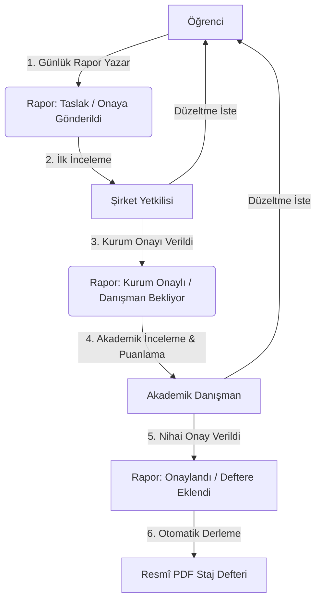

# 📘 StajTakip — Sıfırdan İleri Seviyeye Flutter & Firebase Geliştirici Rehberi

> **Sevgili Öğrenci / Geliştirici Adayı,**  
> Flutter dünyasına hoş geldin! Elindeki bu proje (**StajTakip**), sadece çalışan bir mobil uygulama değil; modern yazılım mühendisliği standartlarına, temiz mimari (Clean/Layered Architecture) prensiplerine, kurumsal durum yönetimine (Cubit) ve uçtan uca Firebase güvenliğine sahip **örnek bir referans projedir**.  
> 
> Bu rehber; Flutter'a yeni başlayan biri olarak projeyi **büyük resimden en küçük kod parçasına kadar** adım adım anlaman, mantığını kavramın ve kendi projelerinde bu yaklaşımları uygulayabilmen için hazırlandı.

---

## 🗺️ İÇİNDEKİLER

1. [Büyük Resim: StajTakip Nedir ve Ne Yapar?](#1-büyük-resim-stajtakip-nedir-ve-ne-yapar)
2. [Mimari Tasarım: Neden Katmanlı Mimari (Layered Architecture)?](#2-mimari-tasarım-neden-katmanlı-mimari)
3. [Klasör Yapısının Anatomisi](#3-klasör-yapısının-anatomisi)
4. [Flutter ve Dart'ın Temel Yapı Taşları](#4-flutter-ve-dartın-temel-yapı-taşları)
5. [Durum Yönetimi (State Management): flutter_bloc & Cubit](#5-durum-yönetimi-state-management-flutter_bloc--cubit)
6. [Merkezi Navigasyon: GoRouter ve StatefulShellRoute](#6-merkezi-navigasyon-gorouter-ve-statefulshellroute)
7. [Veri Katmanı & Repository Deseni (Repository Pattern)](#7-veri-katmanı--repository-deseni)
8. [Firebase Dünyası: Authentication, Firestore ve Güvenlik Kuralları](#8-firebase-dünyası-auth-firestore-ve-güvenlik-kuralları)
9. [PDF Staj Defteri Üretimi ve Türkçe Karakter Yönetimi](#9-pdf-staj-defteri-üretimi-ve-türkçe-karakter-yönetimi)
10. [Test Kültürü: Birim (Unit), Cubit ve Widget Testleri](#10-test-kültürü-birim-cubit-ve-widget-testleri)
11. [Flutter Öğrenme Yol Haritası ve Altın Öğütler](#11-flutter-öğrenme-yol-haritası-ve-altın-öğütler)

---

## 1. Büyük Resim: StajTakip Nedir ve Ne Yapar?

Geleneksel üniversite stajlarında öğrenciler her gün yaptıkları işleri fiziksel bir deftere yazar, staj bitiminde şirketteki yetkiliye imzalattırır ve son olarak üniversitedeki danışman hocaya teslim eder. Bu süreçte defterler kaybolabilir, mükerrer veya sahte günler yazılabilir ve onay süreçleri şeffaf işlemez.

**StajTakip**, bu süreci bütünüyle dijitalleştiren rol tabanlı bir mobil uygulamadır.



### Sistemdeki 3 Farklı Rol:
1. **Öğrenci (`student`):** Staj ilerleme durumunu görür (ör. 15/40 gün), günlük çalışma raporu oluşturur, hafta sonuna rapor yazamaz, taslak kaydeder, onaya gönderir ve onaylanan kayıtlarından otomatik **PDF Staj Defteri** çıktısı alır.
2. **Şirket Yetkilisi (`companyRepresentative`):** Kendisine atanmış stajyerlerin raporlarını inceler, eksik görürse gerekçe yazarak düzeltmeye gönderir veya onaylar.
3. **Akademik Danışman (`academicAdvisor`):** Şirket yetkilisinin onayladığı raporları inceler, stajyere 100 üzerinden not verir ve nihai staj onayını gerçekleştirir.

---

## 2. Mimari Tasarım: Neden Katmanlı Mimari?

Flutter'a yeni başlayanların yaptığı en büyük hata, veritabanı kodlarını doğrudan ekranların (`Widget`) içine yazmaktır:
```dart
// ❌ KÖTÜ VE YANLIŞ YAKLAŞIM (Spagetti Kod):
class MyWidget extends StatelessWidget {
  Widget build(BuildContext context) {
    return ElevatedButton(
      onPressed: () {
        // Ekranın içinde doğrudan Firebase çağrısı! Test edilemez, değiştirilemez!
        FirebaseFirestore.instance.collection('reports').add({...});
      },
      child: Text('Kaydet'),
    );
  }
}
```

Bu projede uyguladığımız profesyonel akış **Tek Yönlü Veri Akışıdır (Unidirectional Data Flow)**:

```text
┌─────────────────────────────────────────────────────────────┐
│  1. GÖRSEL KATMAN (View / Widget)                           │
│     - Kullanıcı butona tıklar veya formu doldurur.          │
│     - Ekranda sadece UI widget'ları yer alır.               │
└──────────────────────────────┬──────────────────────────────┘
                               │ UI olayı (cubit.submit())
                               ▼
┌─────────────────────────────────────────────────────────────┐
│  2. DURUM YÖNETİMİ KATMANI (Cubit / Bloc)                   │
│     - İş kurallarını (business logic) çalıştırır.           │
│     - Hafta sonu mu? Alanlar boş mu? Doğrular.              │
│     - Ekrana durum (State) yayar: Loading, Success, Error.  │
└──────────────────────────────┬──────────────────────────────┘
                               │ Veri isteği (repository.save())
                               ▼
┌─────────────────────────────────────────────────────────────┐
│  3. VERİ KATMANI (Repository)                               │
│     - Verinin nereden geldiğini soyutlar.                   │
│     - Model nesnelerini Map'e, Map'leri nesneye çevirir.    │
│     - Hataları Türkçe 'Failure' nesnelerine dönüştürür.     │
└──────────────────────────────┬──────────────────────────────┘
                               │ SDK çağrısı
                               ▼
┌─────────────────────────────────────────────────────────────┐
│  4. VERİ KAYNAĞI (Firebase SDK / Local Database)            │
│     - Cloud Firestore, Firebase Auth, Firebase Storage.     │
└─────────────────────────────────────────────────────────────┘
```

> **Önemli İlke:** `View`, Firebase diye bir şeyin varlığından haberdar değildir; yalnızca `Cubit` ile konuşur. `Cubit` de Firebase'in detaylarını bilmez; yalnızca `Repository` ile konuşur. Bu sayede yarın Firebase yerine başka bir veritabanına geçilmek istense, ekran kodlarının tek bir satırı bile değişmez!

---

## 3. Klasör Yapısının Anatomisi

Projedeki `lib/` klasörü şu düzenle oluşturulmuştur:

```text
lib/
├── app.dart                   # MaterialApp.router, global tema ve provider tanımları
├── main.dart                  # Flutter & Firebase başlatma (main fonksiyonu)
│
├── core/                      # Uygulama genelinde paylaşılan çekirdek araçlar
│   ├── constants/             # Sabitler (AppConstants: limitler, dosya boyutları)
│   ├── errors/                # Hata ve istisna sınıfları (Failure, AppException)
│   ├── router/                # Sayfa yönlendirme motoru (AppRouter, RouteNames, Shells)
│   ├── theme/                 # Renk paleti (AppColors), Tipografi ve Tema (AppTheme)
│   └── utils/                 # Yardımcı sınıflar (DateFormatter, WorkdayCalculator)
│
├── common/                    # Projede birden fazla ekranda kullanılan ortak widget'lar
│   └── widgets/               # AppButton, AppTextField, AppCard, StatusBadge, ProgressCard
│
├── data/                      # Veri katmanı (İş kurallarından ve ekrandan bağımsız)
│   ├── models/                # UserModel, InternshipModel, DailyReportModel, ReviewModel
│   └── repositories/          # AuthRepository, UserRepository, DailyReportRepository...
│
└── features/                  # Özellik bazlı modüller (Her modül kendi ekran ve Cubit'ine sahiptir)
    ├── auth/                  # Giriş, Kayıt, Şifre Sıfırlama
    ├── dashboard/             # Öğrenci ana paneli ve istatistik sayaçları
    ├── daily_reports/         # Günlük rapor formu, rapor listesi, arama ve filtreler
    ├── approvals/             # Kurum yetkilisi ve danışman onay arayüzleri
    ├── internship/            # İlerleme takvimi, kronolojik iş günleri, eksik gün hesabı
    ├── documents/             # PDF Staj Defteri üretim servisi ve önizleme ekranı
    └── profile/               # Kullanıcı profili ve güvenli oturum kapatma
```

---

## 4. Flutter ve Dart'ın Temel Yapı Taşları

### 4.1. StatelessWidget vs StatefulWidget
- **StatelessWidget:** Ekranın durumu kullanıcı etkileşimiyle değişmiyorsa veya durum dışarıdan bir durum yöneticisi (Cubit/Bloc) tarafından yönetiliyorsa kullanılır. Projemizdeki ekranların neredeyse tamamı `StatelessWidget`'tır; çünkü ekranın durumunu `Cubit` yönetir.
- **StatefulWidget:** Sadece yerel animasyon kontrolcüleri (`AnimationController`) veya metin kutusu kontrolcüleri (`TextEditingController`) gibi widget'ın kendisine ait geçici nesneleri yönetmek gerektiğinde kullanılır.

### 4.2. Asenkron Programlama (`Future`, `Stream`, `async`, `await`)
- **`Future<T>`:** Gelecekte bir kez tamamlanacak bir işlemi temsil eder (örneğin kullanıcının giriş yapması veya bir raporun Firestore'a kaydedilmesi).
  ```dart
  Future<void> signIn(String email, String password) async {
    final credential = await _auth.signInWithEmailAndPassword(email: email, password: password);
  }
  ```
- **`Stream<T>`:** Zaman içinde birden fazla veri akışı sunan boru hattıdır (örneğin kullanıcının oturum durumu değiştiğinde veya Firestore'da yeni bir rapor eklendiğinde anında ekrana yansıması).
  ```dart
  Stream<List<DailyReportModel>> getReportsStream(String internshipId) {
    return _firestore.collection('dailyReports').snapshots().map(...);
  }
  ```

### 4.3. Null Safety (Boş Değer Güvenliği)
Dart dili, `NullPointerException` hatalarını derleme aşamasında engeller:
- `String` -> Asla null olamaz. Mutlaka bir metin içermelidir.
- `String?` -> Null olabilir veya bir metin içerebilir.
- `required` -> Bir constructor parametresinin zorunlu olduğunu belirtir.

### 4.4. `Equatable` ile Değer Eşitliği
Normalde Dart'ta iki nesnenin içeriği aynı olsa bile hafızadaki adresleri farklıysa eşit sayılmazlar (`User('ali') != User('ali')`). `equatable` paketi, nesnelerin alanlarını karşılaştırarak Cubit'in gereksiz yere ekranı yeniden çizmesini (rebuild) engeller:
```dart
class UserModel extends Equatable {
  final String uid;
  final String email;

  const UserModel({required this.uid, required this.email});

  @override
  List<Object?> get props => [uid, email]; // Bu alanlar aynıysa iki nesne eşittir!
}
```

---

## 5. Durum Yönetimi (State Management): flutter_bloc & Cubit

### Neden `setState` Kullanmadık?
`setState`, yalnızca küçük ve tek bir widget içindeki basit sayaçlar için uygundur. Büyük bir projede `setState` kullanırsanız:
1. Tüm ekran baştan aşağı gereksiz yere tekrar çizilir (performans kaybı).
2. İş mantığı UI kodlarının arasına karışır.
3. Ekran durumlarını (Yükleniyor, Hata, Başarılı, Boş Veri) test etmek imkânsız hale gelir.

### Cubit Nasıl Çalışır?
Cubit, bir **Durum Makinesidir (State Machine)**. Dışarıdan fonksiyon çağrısı alır, içeride iş mantığını işletir ve dışarıya yeni bir durum (`State`) yayar (`emit`).

Örnek: [DailyReportFormCubit](file:///c:/Users/aygen/OneDrive/Masaüstü/softito-mobil-app-developer-yuzyuze-main/21_ekim/21_ekim_staj_takip_uygulamasi/lib/features/daily_reports/cubit/daily_report_form_cubit.dart)
```dart
// 1. Durumlar (States):
abstract class DailyReportFormState {}
class DailyReportFormInitial extends DailyReportFormState {}
class DailyReportFormReady extends DailyReportFormState {
  final DateTime workDate;
  final String tasks;
  // ...
}
class DailyReportFormLoading extends DailyReportFormState { final String message; ... }
class DailyReportFormSuccess extends DailyReportFormState { ... }
class DailyReportFormFailure extends DailyReportFormState { final String message; ... }

// 2. Cubit:
class DailyReportFormCubit extends Cubit<DailyReportFormState> {
  DailyReportFormCubit(...) : super(const DailyReportFormInitial());

  Future<void> submitForApproval() async {
    // A) Doğrulama
    if (state.tasks.isEmpty) {
      emit(DailyReportFormFailure('Yapılan işler boş bırakılamaz!'));
      return;
    }

    // B) Yükleniyor durumu yay
    emit(DailyReportFormLoading(message: 'Rapor gönderiliyor...'));

    try {
      // C) Veritabanına kaydet
      await repository.createReport(report);
      // D) Başarı durumu yay
      emit(DailyReportFormSuccess(message: 'Rapor onaya gönderildi.'));
    } catch (e) {
      // E) Hata durumu yay
      emit(DailyReportFormFailure(e.toString()));
    }
  }
}
```

### UI Tarafında Cubit'i Dinleme:
- **`BlocBuilder`:** Durum değiştikçe yeni arayüz çizmek için kullanılır (ör. Loading durumunda spinner, Success durumunda liste göstermek).
- **`BlocListener`:** Durum değiştiğinde tek seferlik aksiyon almak için kullanılır (ör. SnackBar göstermek, başka sayfaya yönlendirmek `context.pop()`).
- **`BlocConsumer`:** Hem çizim (`builder`) hem de dinleme (`listener`) ihtiyacı olduğunda ikisini birleştirir.

---

## 6. Merkezi Navigasyon: GoRouter ve StatefulShellRoute

Flutter'ın eski `Navigator.push` yöntemi karmaşık uygulamalarda rota yönetimini zorlaştırır. Projemizde endüstri standardı olan **GoRouter** kullanılmıştır.

### 6.1. Oturum Koruması (Redirect / Guard Mekanizması)
Kullanıcı giriş yapmamışsa, URL'den veya butondan korumalı bir sayfaya gidemez. [app_router.dart](file:///c:/Users/aygen/OneDrive/Masaüstü/softito-mobil-app-developer-yuzyuze-main/21_ekim/21_ekim_staj_takip_uygulamasi/lib/core/router/app_router.dart) içindeki `redirect` fonksiyonu her rota geçişinde çalışır:

```dart
redirect: (context, state) {
  final authState = authCubit.state;
  final isLoggedIn = authState is AuthAuthenticated;
  final isAuthRoute = state.matchedLocation == RouteNames.login ||
                      state.matchedLocation == RouteNames.register;

  // 1. Giriş yapmamış kullanıcı korumalı sayfaya giderse -> Giriş ekranına yönlendir
  if (!isLoggedIn && !isAuthRoute) {
    return RouteNames.login;
  }

  // 2. Giriş yapmış kullanıcı giriş ekranına gitmeye çalışırsa -> Rolüne göre ana paneline yönlendir
  if (isLoggedIn && isAuthRoute) {
    if (user.role.isStudent) return RouteNames.studentDashboard;
    if (user.role.isCompanyRepresentative) return RouteNames.companyDashboard;
    if (user.role.isAcademicAdvisor) return RouteNames.advisorDashboard;
  }

  return null; // Her şey yolundaysa gitmek istediği sayfaya izin ver
}
```

### 6.2. `StatefulShellRoute.indexedStack` (Alt Menü Koruması)
Öğrenci uygulamasında alt menüde (Bottom Navigation Bar) 4 sekme vardır:
1. Ana Sayfa
2. Günlüğüm
3. İlerlemem
4. Profil

Normal bir `PageView` veya `Navigator` ile sekmeler arasında geçiş yapıldığında sayfa baştan yüklenir ve kullanıcının scroll konumu kaybolur. **`StatefulShellRoute.indexedStack`**, tüm sekmeleri hafızada canlı tutar; sekmeler arası geçiş yapıldığında ekran sıfırlanmaz, kullanıcının kaldığı yer korunur.

---

## 7. Veri Katmanı & Repository Deseni

Veri modellerimiz Firestore'daki dokümanlarla Dart sınıfları arasında köprü kurar.

### 7.1. Model Serileştirme (`fromMap` ve `toMap`)
Firestore verileri anahtar-değer (`Map<String, dynamic>`) şeklinde JSON benzeri formatta tutar.
- **`toMap()`:** Dart nesnesini Firestore'a kaydetmek için `Map`'e dönüştürür.
- **`fromMap()`:** Firestore'dan gelen `Map`'i Dart nesnesine dönüştürür.

Örnek: [DailyReportModel](file:///c:/Users/aygen/OneDrive/Masaüstü/softito-mobil-app-developer-yuzyuze-main/21_ekim/21_ekim_staj_takip_uygulamasi/lib/data/models/daily_report_model.dart)
```dart
Map<String, dynamic> toMap() {
  return {
    'internshipId': internshipId,
    'workDate': Timestamp.fromDate(workDate), // DateTime -> Firestore Timestamp dönüşümü
    'tasks': tasks,
    'hoursWorked': hoursWorked,
    'status': status.value, // Enum -> String dönüşümü
  };
}
```

### 7.2. Atomik İşlemler (Firestore `WriteBatch`)
Bir yetkili raporu onayladığında veya düzelttiğinde **iki işlem aynı anda** gerçekleşmelidir:
1. `dailyReports` koleksiyonundaki raporun durumu güncellenmeli.
2. `reviews` koleksiyonuna yeni bir denetim izi (audit log) belgesi eklenmeli.

Eğer 1. işlem başarılı olur ama internet kopup 2. işlem başarısız olursa veritabanı tutarsız hale gelir. Bunu engellemek için **`WriteBatch`** kullandık:
```dart
final batch = _firestore.batch();
batch.set(reviewRef, reviewModel.toMap());
batch.update(reportRef, {'status': 'approved', 'companyApproved': true});
await batch.commit(); // İki işlem ya birlikte başarılı olur, ya da ikisi de iptal edilir!
```

---

## 8. Firebase Dünyası: Auth, Firestore ve Güvenlik Kuralları

### 8.1. Spark Planı vs Blaze Planı
- **Spark Planı:** Firebase'in tamamen ücretsiz planıdır. Authentication ve Firestore'u ücretsiz sunar.
- **Blaze Planı:** Kullandıkça öde planıdır; kredi kartı tanımlaması gerektirir. Firebase Storage'ın yeni bucket yapılandırmalarında Blaze istenebilmektedir.
- **Mimari Esnekliğimiz:** Kullanıcımız Spark planında kalmak istediğinde projenin mimarisini bozmadık; rapor formundaki ek dosya yükleme alanını isteğe bağlı (opsiyonel) tutarak uygulamanın ücretsiz planda firesiz çalışmasını sağladık.

### 8.2. Firestore Güvenlik Kuralları ([firestore.rules](file:///c:/Users/aygen/OneDrive/Masaüstü/softito-mobil-app-developer-yuzyuze-main/21_ekim/21_ekim_staj_takip_uygulamasi/firestore.rules))
Güvenlik arayüzde buton gizlemekle sağlanmaz! Kötü niyetli bir kullanıcı curl veya API araçlarıyla veritabanınıza doğrudan istek atabilir. Kurallarımız şunları garanti eder:
1. **Rol Yükseltme Engeli:** Bir kullanıcı kayıt olurken istemciden `role: "admin"` gönderse bile veritabanı kuralı bunu reddeder ve yalnızca `student` rolüne izin verir.
2. **Kendi Onayını Verme Engeli:** Öğrenci kendi raporundaki `companyApproved` veya `advisorApproved` alanını `true` yapamaz; bu alanları sadece staja atanmış yetkili değiştirebilir.
3. **Mazeretsiz Düzeltme Engeli:** Bir yetkili "Düzeltme İste" dediğinde açıklama (`comment`) girmek zorundadır; boş yorumla düzeltme kararı gönderilemez.

---

## 9. PDF Staj Defteri Üretimi ve Türkçe Karakter Yönetimi

Projemizin en havalı modüllerinden biri [pdf_generator_service.dart](file:///c:/Users/aygen/OneDrive/Masaüstü/softito-mobil-app-developer-yuzyuze-main/21_ekim/21_ekim_staj_takip_uygulamasi/lib/features/documents/services/pdf_generator_service.dart) servisidir.

### Temel PDF Kuralları:
1. **Sadece Onaylı Raporlar:** Henüz kurum veya danışman onayından geçmemiş taslak raporlar deftere dahil edilmez.
2. **Türkçe Karakter Desteği:** Standart PDF fontları (Helvetica vb.) Türkçe karakterleri (`ğ`, `ı`, `ş`, `İ`) desteklemez ve bozuk gösterir. Bu yüzden `PdfGoogleFonts.roboto` font ailesi kullanılarak UTF-8 desteği sağlandı.
3. **Otomatik Sayfalama (`MultiPage`):** Öğrencinin 40 günlük raporu tek bir sayfaya sığmaz. `pw.MultiPage` bileşeni sayesinde içerik uzadıkça otomatik yeni sayfa açılır ve altbilgide "Sayfa X / Y" formatında sayfa numarası basılır.

---

## 10. Test Kültürü: Birim, Cubit ve Widget Testleri

Profesyonel yazılım geliştirmede test yazılmayan kod tamamlanmış sayılmaz. Projemizde **42 adet otomatik test** bulunmaktadır.

### 10.1. Mocktail ile Taklit Nesneler (Mocking)
Test çalıştırırken gerçek Firebase veritabanına bağlanmak istemeyiz (çünkü yavaştır, internet gerektirir ve kotayı harcar). `mocktail` ile sahte bir veritabanı davranışı tanımlarız:
```dart
// Test esnasında sanki öğrencinin stajı yokmuş gibi davran:
when(() => mockInternshipRepository.getActiveInternshipStream('student-123'))
    .thenAnswer((_) => Stream.value(null));

// Cubit'in 'DashboardNoInternship' durumu yaydığını doğrula:
expect(cubit.state, isA<DashboardNoInternship>());
```

### 10.2. Kod Analizi (`dart analyze` ve `dart format`)
Terminalde `dart analyze lib test` komutunu çalıştırdığımızda `No issues found!` çıktısını almak; kodumuzda hiçbir syntax hatası, kullanılmayan import veya tip uyumsuzluğu olmadığını kanıtlar.

---

## 11. Flutter Öğrenme Yol Haritası ve Altın Öğütler

Flutter yolculuğuna yeni başlamış bir geliştirici olarak şu altın kuralları aklından çıkarma:

1. **Önce Dart Temellerini Çok İyi Kavra:** OOP (Nesne Yönelimli Programlama), Interfaces, Mixins, Generics, Stream ve Future yapılarını iyi bilmeyen biri Flutter'da zorlanır.
2. **Widget Ağacını Küçük Tut:** 500 satırlık devasa tek bir widget yazma. Ekrandaki kartları, butonları, form alanlarını ayrı küçük widget sınıflarına böl.
3. **İş Mantığını Ekrandan Uzak Tut:** Arayüz (UI) aptal olmalıdır (Dumb UI). Ekranda sadece ne gösterileceği belirlenmeli; "veritabanına ne yazılacak, hangi koşulda hata verilecek" kararları `Cubit` katmanında kalmalıdır.
4. **Hataları Anlaşılır Mesajlara Çevir:** Kullanıcıya asla `FirebaseException: code: 404` gösterme. Her zaman "İnternet bağlantınızı kontrol ediniz" veya "Girdiğiniz şifre hatalı" gibi Türkçe ve nazik mesajlar göster (`Failure` sınıfı).
5. **Sabırlı Ol ve Kodu İncele:** Bu projeyi emülatörde çalıştır, breakpoint koyarak kodun adım adım `View -> Cubit -> Repository -> Firebase` zincirinde nasıl aktığını izle.

---

*Başarılar dilerim! Bu rehber ve proje, mobil uygulama geliştirme kariyerinde sana her zaman güçlü bir pusula olacaktır.* 🚀
