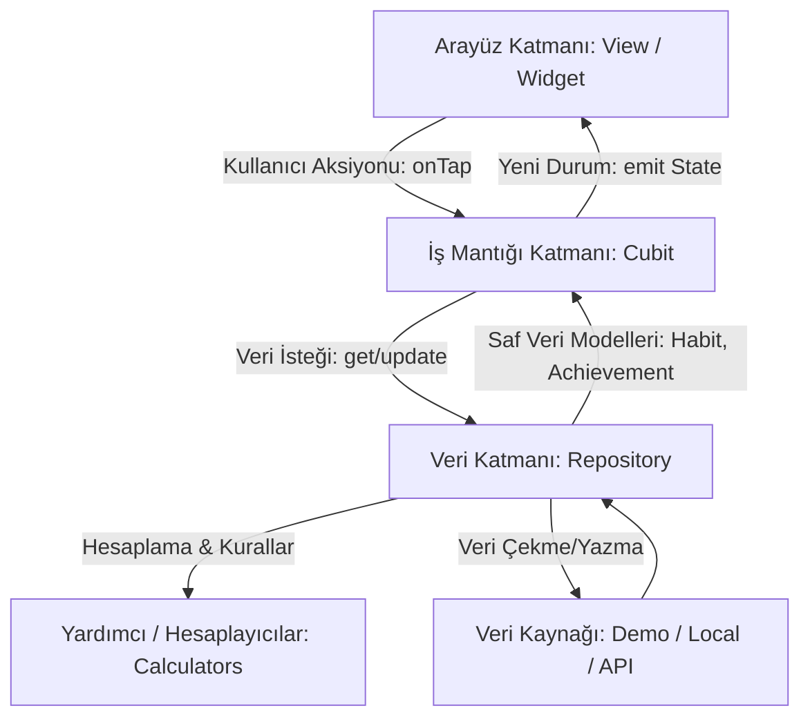

# 🌿 Verdant Projesi ile Flutter Öğrenci Rehberi

## 📌 İçindekiler
1. [Büyük Resim (The Big Picture): Flutter Nasıl Düşünür?](#1-büyük-resim-the-big-picture-flutter-nasıl-düşünür)
2. [Mimarimiz: Neden ve Nasıl Bir Mimari Kurduk?](#2-mimarimiz-neden-ve-nasıl-bir-mimari-kurduk)
3. [Klasör Yapısı: Neyin Nerede Olduğunu Bilmek](#3-klasör-yapısı-neyin-nerede-olduğunu-bilmek)
4. [Ney, Neyle İlişkili? (Somut Senaryolar Üzerinden Veri Akışı)](#4-ney-neyle-ilişkili-somut-senaryolar-üzerinden-veri-akışı)
5. [Flutter'ın Kalbi: Kodlar Üzerinden Temel Kavramlar](#5-flutterın-kalbi-kodlar-üzerinden-temel-kavramlar)
   - [StatelessWidget vs StatefulWidget](#51-statelesswidget-vs-statefulwidget)
   - [State Management: Cubit & BLoC](#52-state-management-cubit--bloc)
   - [BuildContext Nedir ve Neden Hayatidir?](#53-buildcontext-nedir-ve-neden-hayatidir)
   - [GoRouter & StatefulShellRoute (Modern Sekme Navigasyonu)](#54-gorouter--statefulshellroute)
   - [Reaktif Dinleme: ListenableBuilder & TextEditingController](#55-reaktif-dinleme-listenablebuilder)
   - [İmmutability (Değişmezlik) ve copyWith Deseni](#56-immutability-ve-copywith-deseni)
6. [Az Önce Çözdüğümüz Hata Bize Ne Öğretti?](#6-az-önce-çözdüğümüz-hata-bize-ne-öğretti)
7. [İleride Kendi Projelerini Geliştirirken İzleyeceğin Yol Haritası](#7-ileride-kendi-projelerini-geliştirirken-izleyeceğin-yol-haritası)

---

## 1. Büyük Resim (The Big Picture): Flutter Nasıl Düşünür?

Flutter'ı kavramanın birinci altın kuralı şudur:
> **UI = f(state)**  
> *(Arayüz, o anki durumun matematiksel bir fonksiyonudur.)*

Geleneksel web veya eski mobil geliştirmede (HTML/JS veya Android XML), bir butona basıldığında DOM'daki bir elementi bulup elle rengini veya yazısını değiştirirdiniz (`document.getElementById("btn").text = "..."`).  
**Flutter'da bu asla yapılmaz.**

Flutter'da:
1. Bir **Durum (State)** vardır (örneğin: `suMiktari = 1500`).
2. Arayüzünüz bu durumu dinler (`Text('$suMiktari ml')`).
3. Butona tıklandığında sadece durumu güncellersiniz (`suMiktari = 1750`).
4. Flutter, değişen parçayı tespit eder ve arayüzü saniyenin 60'ta veya 120'de birinde **yeniden çizer**.

### Her Şey Bir Widget'tır (Everything is a Widget)
Flutter'da ekranda gördüğün yazı (`Text`), buton (`ElevatedButton`), hizalama (`Center`), boşluk (`SizedBox`), hatta uygulamanın kendisi (`MaterialApp`) birer **Widget**'tır. Widget'lar bir araya gelerek bir **Ağaç (Widget Tree)** oluşturur.

---

## 2. Mimarimiz: Neden ve Nasıl Bir Mimari Kurduk?

Birçok yeni başlayan yazılımcının yaptığı en büyük hata, veritabanı sorgularını, iş kurallarını ve arayüz çizim kodlarını tek bir dosya içine yığmaktır. Buna sektörde **"Spagetti Kod"** denir.

Biz Verdant projesinde **Katmanlı ve Özellik Odaklı (Feature-First Clean Architecture)** bir mimari kurduk:



### Katmanların Görev Dağılımı:
1. **View (Ekran / Arayüz):** Sadece pikselleri ekrana çizer. Karar vermez, hesaplama yapmaz. "Butona basıldı, ne yapayım?" diye Cubit'e sorar.
2. **Cubit (İş Mantığı & Durum Yönetimi):** Ekranın beynidir. Ekrandan gelen emri alır, Repository'den veriyi günceller ve arayüze "Yeni durum hazır, kendini yeniden çiz" (`emit`) der.
3. **Repository (Veri Yönetim Deposu):** Verinin nereden geldiğiyle ilgilenir. İster yerel demo verisi olsun, ister SQLite veritabanı, ister internetteki bir REST API... Cubit verinin nereden geldiğini bilmez, sadece Repository'den ister.
4. **Model (Veri Kalıbı):** Uygulamadaki nesnelerin (Alışkanlık, Rozet, Kullanıcı) özelliklerini tanımlayan saf Dart sınıflarıdır.

---

## 3. Klasör Yapısı: Neyin Nerede Olduğunu Bilmek

Projenin `lib/` dizinine baktığında göreceğin yapı ve her bir klasörün sorumluluğu:

```text
lib/
├── main.dart                  # Uygulamanın giriş noktası (Engine başlangıcı, Bağımlılıklar)
├── app.dart                   # MaterialApp, Tema ve Router'ın bağlandığı ana kabuk
│
├── app/                       # Uygulama genel yapılandırması
│   └── router/                # Sayfalar arası geçiş rotaları (GoRouter, RouteNames)
│
├── core/                      # Tüm projenin ortak kullandığı "çekirdek" araçlar
│   ├── theme/                 # Renk paletleri, font stilleri, kenar yuvarlaklıkları (Design Tokens)
│   ├── utils/                 # Saf hesaplama fonksiyonları (Streak hesabı, Tarih biçimlendirme)
│   └── widgets/               # Her sayfada tekrar tekrar kullanılabilen atomik bileşenler
│                              # (Örn: AppButton, BrandLogo, PasswordValidationIndicator)
│
├── models/                    # Saf veri sınıfları (Habit, HabitCategory, Achievement)
│
├── data/                      # Veri katmanı
│   ├── demo/                  # Başlangıç ve sahte (mock) verileri
│   └── repositories/          # Veri alışverişini yöneten sınıflar (HabitRepository)
│
└── features/                  # Uygulamanın ekran/özellik bazlı modülleri
    ├── onboarding/            # Karşılama, Giriş ve Kayıt modülü
    ├── home/                  # Günlük pano, Hidrasyon, Günün sözü
    ├── calendar/              # Aylık/Haftalık takvim görünümü ve geçmiş aktiviteler
    ├── statistics/            # Grafiksel analizler, Rozetler, Başarı karnesi
    ├── habits/                # Tüm alışkanlıklar listesi, Alışkanlık Ekleme/Düzenleme Formu
    └── profile/               # Profil kartı, Bilgi güncelleme, Şifre değiştirme
```

---

## 4. Ney, Neyle İlişkili? (Somut Senaryolar Üzerinden Veri Akışı)

Kafandaki en büyük soru işaretinin *"Bu dosya diğer dosyayla nasıl konuşuyor?"* olduğunu biliyoruz. Gel bunu projemizdeki gerçek 3 senaryo üzerinden adım adım inceleyelim:

### Senaryo 1: Ana Sayfada Su Kartında "+250 ml Ekle" Butonuna Basıldığında Ne Olur?

```
[Kullanıcı Butona Basar]
       │
       ▼
1. home_screen.dart (HydrationCard onAddWater callback'i tetiklenir)
       │  cubit.addWater(250);
       ▼
2. home_cubit.dart (HomeCubit fonksiyonu çalışır)
       │  habitRepository.updateProgress('water_3l', 250);
       ▼
3. habit_repository_impl.dart (Alışkanlığın bugünkü ilerlemesini artırır)
       │  progressCalculator.calculateDailyProgress(habits);
       ▼
4. home_cubit.dart (Hesaplanan yeni değerlerle yeni state üretilir)
       │  emit(state.copyWith(waterConsumed: 1750, dailyProgress: 0.65));
       ▼
5. home_screen.dart (BlocBuilder yeni state'i yakalar)
       │  Arayüz 16 milisaniyede güncellenir: İlerleme barı animasyonla dolar!
```

---

### Senaryo 2: Şifre Alanına `Aygen2005` Yazıldığında Canlı Validasyon Nasıl Çalışır?

Burada state yönetimi için Cubit'e bile gitmeden, saf Flutter'ın **dinleyici (listener)** gücünü kullandık:

```dart
// 1. Controller metni hafızada tutar:
final _passwordController = TextEditingController();

// 2. Parola TextField'ına bu controller bağlanır:
TextField(
  controller: _passwordController,
  obscureText: _obscurePassword,
  ...
)

// 3. PasswordValidationIndicator bileşeni controller'ı ListenableBuilder ile dinler:
ListenableBuilder(
  listenable: controller,
  builder: (context, _) {
    final pwd = controller.text;
    // Her tuş vuruşunda bu fonksiyonlar çalışır:
    final upperValid = RegExp(r'[A-ZÇĞİÖŞÜ]').hasMatch(pwd); // 'A' girilince TRUE
    final digitValid = RegExp(r'[0-9]').hasMatch(pwd);       // '2' girilince TRUE
    final lengthValid = pwd.length >= 8;                     // 8 harfi geçince TRUE
    
    // AnimatedContainer ile ilgili satır anında yeşil onay rozetine dönüşür!
  },
);
```

---

## 5. Flutter'ın Kalbi: Kodlar Üzerinden Temel Kavramlar

### 5.1 StatelessWidget vs StatefulWidget

* **`StatelessWidget`:** Kendisine ait zamanla değişen bir iç durumu (state) olmayan widget'lardır. Verisini dışarıdan alır ve sadece çizer.
  * *Projemizdeki Örnek:* [`BrandLogo`](file:///c:/Users/aygen/OneDrive/Masaüstü/softito-mobil-app-developer-yuzyuze-main/22_ekim/aliskanlik_takibi_uygulamasi/lib/core/widgets/brand_logo.dart) veya [`DailyProgressCard`](file:///c:/Users/aygen/OneDrive/Masaüstü/softito-mobil-app-developer-yuzyuze-main/22_ekim/aliskanlik_takibi_uygulamasi/lib/features/home/widgets/daily_progress_card.dart). Sadece verilen `progress` değerini çizer.
* **`StatefulWidget`:** Kendi içinde değişen bir hafızaya (duruma) sahip widget'lardır.
  * *Projemizdeki Örnek:* [`ProfileModalSheet`](file:///c:/Users/aygen/OneDrive/Masaüstü/softito-mobil-app-developer-yuzyuze-main/22_ekim/aliskanlik_takibi_uygulamasi/lib/features/profile/view/profile_modal_sheet.dart). Göz ikonuna tıklandığında şifreyi göstermek için `_obscureOldPassword = !_obscureOldPassword` der ve `setState(() {})` çağırarak sadece o modalın ekranını tazeler.

---

### 5.2 State Management: Cubit & BLoC

Neden her yerde `setState` kullanmıyoruz? Çünkü `setState` sadece o anki küçük widget içinde çalışır. Oysa bir alışkanlık tamamlandığında:
* Ana Sayfadaki günlük ilerleme artmalı,
* İstatistik sayfasındaki haftalık grafik güncellenmeli,
* Rozet kazanıldıysa kupa parlamalı!

Tüm bu ekranların aynı dili konuşması için **Cubit** kullanıyoruz:

```dart
// State: Ekranın o anki fotoğrafı
class HomeState {
  final List<Habit> habits;
  final double dailyProgress;
  final int waterConsumed;
  ...
}

// Cubit: Olayları yöneten komuta merkezi
class HomeCubit extends Cubit<HomeState> {
  HomeCubit(...) : super(HomeState.initial());

  void toggleHabit(String habitId) {
    // 1. Veriyi güncelle
    // 2. emit(...) ile yeni durumu dünyaya duyur!
    emit(state.copyWith(habits: updatedList, dailyProgress: newProgress));
  }
}
```

Arayüzde bunu nasıl dinliyoruz?
* **`BlocBuilder`:** Durum değiştikçe arayüzü yeniden inşa eder.
* **`BlocListener`:** Durum değiştiğinde arayüz çizmek yerine bir kerelik bir aksiyon yapar (Örn: Hata SnackBar'ı göstermek veya başka sayfaya yönlendirmek).

---

### 5.3 BuildContext Nedir ve Neden Hayatidir?

`build(BuildContext context)` fonksiyonunu her widget'ta görürsün.
* `context`, o widget'ın **bütün widget ağacındaki konum koordinatıdır**.
* "Ben ağacın neresindeyim? Üstümde hangi tema (`Theme.of(context)`), hangi Cubit (`context.read<HomeCubit>()`) veya hangi ekran boyutu (`MediaQuery.of(context)`) var?" sorularının cevabını `context` verir.

---

### 5.4 GoRouter & StatefulShellRoute

Kullanıcı "Takvim" sekmesine basıp bir güne tıkladıktan sonra "Ana Sayfa"ya dönüp tekrar "Takvim"e basarsa ne olur? Sayfanın sıfırlanmasını istemeyiz, kaldığı yerde kalmalıdır!

Bunu [`lib/app/router/app_router.dart`](file:///c:/Users/aygen/OneDrive/Masaüstü/softito-mobil-app-developer-yuzyuze-main/22_ekim/aliskanlik_takibi_uygulamasi/lib/app/router/app_router.dart) içinde **`StatefulShellRoute.indexedStack`** ile çözdük.
* `IndexedStack`, 4 ana ekranı (Home, Calendar, Statistics, Habits) bellekte canlı tutar; sadece öne çıkan ekranın görünürlüğünü değiştirir. Böylece ekranlar arası geçişte veri veya kaydırma konumu kaybolmaz!

---

### 5.5 İmmutability (Değişmezlik) ve copyWith Deseni

Dart'ta modellerimizi neden `final` tanımlıyoruz?

```dart
class Habit {
  final String id;
  final String title;
  final bool isCompletedToday;
  ...
}
```

Eğer `habit.isCompletedToday = true;` yapabilseydik, nesne hafızada aynı kalırdı ve Flutter değişikliği algılayamayabilirdi.  
Bunun yerine **`copyWith`** metodu ile var olan nesnenin klonunu üretiriz:

```dart
final updatedHabit = habit.copyWith(isCompletedToday: true);
```
Bu sayede Flutter `eskiNesne != yeniNesne` olduğunu anlar ve ekranı anında yeniler.

---

## 6. Az Önce Çözdüğümüz Hata Bize Ne Öğretti?

Az önce karşılaştığımız hata, Flutter öğrenirken karşına çıkabilecek en klasik ve öğretici derslerden biridir:

### Hata Neydi?
"Tüm Alışkanlıklar" sayfasında "Spor Salonuna Git" kartındaki kalem ikonuna bastığımızda uygulama kırmızı hata ekranı veriyordu:
> *"Assertion failed: items.where((item) => item.value == value).length == 1: There should be exactly one item with DropdownButton's value: Hafta"*

### Neden Oldu?
Flutter'ın `DropdownButton` bileşeni çok katı bir güvenlik kuralına sahiptir:  
Dropdown'a verdiğin `value` değeri, dropdown'ın sunduğu seçenekler listesinde (`items`) **birebir aynen bulunmak zorundadır**.  
Formdaki liste `['Dakika', 'Sayfa', 'Adım', 'ml', 'Litre', 'Kez']` idi; ancak alışkanlığın birimi `'Hafta'` ve `'Gün'` idi! Bulamayınca uygulama çöktü.

### Nasıl Profesyonelce Çözdük?
Sadece listeye `'Hafta'` ve `'Gün'` eklemekle kalmadık; gelecekte veritabanından bilinmeyen başka bir birim (örneğin `'Kilo'`) gelirse yine çökmesin diye **dinamik bir koruma getter'ı** yazdık:

```dart
List<String> get _availableUnits {
  // Eğer alışkanlığın birimi listede yoksa, onu anında listeye dahil et!
  if (!units.contains(_targetUnit)) {
    return [...units, _targetUnit];
  }
  return units;
}
```
**Çıkarılan Ders:** Kullanıcıdan veya veritabanından gelen veriler ile arayüzdeki sabit seçenekler eşleşmeyebilir. Her zaman güvenli varsayılanlar (fallback) ve dinamik kontroller kullanmalısın.

---

## 7. İleride Kendi Projelerini Geliştirirken İzleyeceğin Yol Haritası

Bir Flutter projesine sıfırdan başlarken şu adımları izle:

1. **Önce Kalem Kağıt (Tasarım & Varlıklar):**
   * Hangi modellerim var? (Örn: `Todo`, `User`). Bunları `models/` altına `final` alanlarla yaz.
2. **Tema ve Tasarım Sistemi (Design System):**
   * Renklerini (`app_colors.dart`) ve fontlarını (`app_typography.dart`) belirle. Kodun içine asla rastgele `Color(0xFF123456)` yazma, daima temadan çağır.
3. **Repository Katmanı:**
   * Sahte (mock/demo) verilerini üret. Arayüz hazır olmadan önce verilerini hazırla.
4. **Cubit (İş Mantığı):**
   * Hangi durumlar oluşabilir? (Örn: `Loading`, `Success`, `Error`). State sınıfını ve Cubit metodlarını yaz.
5. **En Son: Widget / Ekran Çizimi:**
   * Tasarımı widget parçalarına böl (Büyük kartlar, butonlar, sayaçlar). Bunları `BlocBuilder` ile Cubit'e bağla.

---
*Başarılar dileriz! Artık Verdant projesindeki her bir dosyanın görevini ve Flutter'ın nasıl düşündüğünü biliyorsun. Kodları incelemekten ve denemeler yapmaktan asla çekinme! 🌿*
