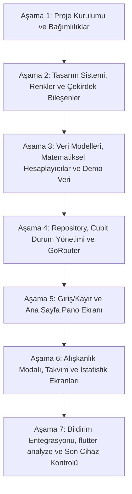

# VERDANT — ALIŞKANLIK TAKİBİ UYGULAMASI GELİŞTİRME PLANI (plan.md)

> Bu plan; `project.md`, `architecture.md`, `design-system.md`, `skills.md`, `.agents.md` ve Stitch tasarım dokümanlarında belirtilen tüm kural, prensip ve kısıtlamalar dikkate alınarak hazırlanmıştır. Geliştirme süreci boyunca bu plana ve belgelenen mimari kurallara kesinlikle sadık kalınacaktır.

---

## 1. Proje Özeti ve Kapsam Kuralları

- **Uygulama Adı:** Verdant (Sağlık ve Kişisel Gelişim Odaklı Alışkanlık Takip Mobil Uygulaması)
- **Teknoloji Yığını:**
  - **Framework & Dil:** Flutter (Material 3 özelleştirilmiş tasarım dili) & Dart
  - **Durum Yönetimi:** `flutter_bloc` (Cubit yapısı — her buton/widget için değil, ekran/özellik bazlı)
  - **Gezinme:** `go_router` (Merkezi yapılandırma, ShellRoute ile 4 sekmeli alt bar)
  - **Grafik & Görselleştirme:** `fl_chart` ve özel çizimler (CustomPainter / Canvas)
  - **Bildirimler:** `flutter_local_notifications` (Yerel cihaz içi bildirimler)
  - **Veri Kaynağı:** Bellekte tutulan tutarlı demo veri fabrikası (`demo_data_factory.dart`)
- **Kesin Yasaklar ve Kısıtlamalar:**
  - Backend, Firebase, Supabase, harici veritabanı (PostgreSQL/SQLite) KULLANILMAYACAK.
  - Gerçek kimlik doğrulama sunucusu KULLANILMAYACAK; "Demo ile Devam Et" akışı işletilecek.
  - Harici REST API veya JSON dosya bağımlılığı KULLANILMAYACAK; veri saf Dart modellerinde yönetilecek.
  - Tüm kullanıcı arayüzü ve geri bildirim metinleri eksiksiz **TÜRKÇE** olacak.
  - Testler minimum düzeyde tutulacak; geliştirme hızı ve UI/UX kalitesi öncelikli olacak.

---

## 2. 5 Başlangıç Demo Alışkanlığı Veri Modeli ve Durum Özeti

1. **Günde 10.000 Adım (Sağlık):**
   - Son 30 günün tamamı eksiksiz tamamlanmış.
   - Takvimde son 30 gün yeşil/dolu; streak ve istatistiklerle %100 tutarlı.
2. **Sigarasız Yaşam (Sağlık):**
   - 30 günlük meydan okumanın 14. gününde (İlerleme: 14/30).
   - Meydan okuma ilerlemesi ile günlük tamamlanma oranı ayrı tutulacak. Görsel tema: Haki & Amber.
3. **Spor Salonuna Git (Spor):**
   - Henüz başlanmamış (0 tamamlama).
   - Nötr/daha soluk görünüm; asla başarısızlık veya kaçırılmış gün gibi gösterilmeyecek.
4. **Her Gün 100 Sayfa Oku (Kişisel Gelişim):**
   - Yeni başladı, 2. gününde.
   - Taze adaçayı yeşili, yeni başlangıç rozeti ve kısa streak göstergesi.
5. **Günde 3 Litre Su (Sağlık):**
   - Hedef 3.000 ml, bugünkü örnek miktar 2.500 ml (%83, henüz tamamlanmadı!).
   - Geçmişinde tamamlanan, kısmi ve kaçırılan günler bulunacak; dinamik motivasyon metinleri içerecek.

---

## 3. Adım Adım Geliştirme Yol Haritası (7 Aşama)

---

### AŞAMA 1: Proje Altyapısı, Bağımlılıklar ve Temel Mimari İskelet

- **Hedef:** Flutter projesini `aliskanlik_takibi_uygulamasi` içinde hazır hale getirmek, `pubspec.yaml` paketlerini eklemek ve katmanlı klasör yapısını kurmak.
- **Yapılacak Geliştirmeler:**
  1. Flutter projesinin başlatılması veya yapılandırılması (`flutter create` ile standarda uygun kurulum).
  2. `pubspec.yaml` içine gerekli paketlerin eklenmesi:
     - `flutter_bloc`
     - `go_router`
     - `fl_chart`
     - `flutter_local_notifications`
     - `intl`
     - `shared_preferences`
     - `google_fonts` (veya yerel tipografi alternatifleri)
  3. Dokümanlarda (`architecture.md`) tanımlanan katmanlı dizin hiyerarşisinin oluşturulması:
     - `lib/core/` (constants, theme, utils, widgets)
     - `lib/data/` (demo, repositories)
     - `lib/models/`
     - `lib/features/` (onboarding, home, habits, calendar, statistics)
     - `lib/services/`
     - `lib/app/` (router, di)
- **Teslimat Kriteri:** Hata vermeden derlenen temiz bir Flutter iskeleti.

---

### AŞAMA 2: Tasarım Sistemi (Design System), Tema ve Çekirdek Widget'lar

- **Hedef:** Stitch çıktısı ve `design-system.md` ile birebir uyumlu, Material 3 tabanlı premium karanlık doğa temasını hayata geçirmek.
- **Yapılacak Geliştirmeler:**
  1. **Renk Token'ları (`app_colors.dart`):**
     - Background: `#0F150F` / `#111711`
     - Surface: `#1B211B` / `#202A21`
     - Surface Elevated: `#252C25` / `#273329`
     - Primary / Surface Tint: `#87966A` / `#BDCD9C`
     - Success: `#8FCA8A` / `#9AD594`
     - In Progress (Amber): `#D7B66D`
     - Text Primary: `#DEE4DA` / `#F2F0E6`
     - Text Secondary: `#A8B2A3` / `#C6C8BB`
     - Outline / Border: `#45483E` / `#909286`
  2. **Tipografi & Spacing (`app_theme.dart`, `app_spacing.dart`, `app_radius.dart`):**
     - 4, 8, 12, 16, 20, 24, 32 birimlik boşluk sistemi.
     - 8–12 (kontroller), 14–18 (butonlar), 18–24 (kartlar), 28–32 (modal) köşe yarıçapları.
  3. **Yeniden Kullanılabilir Çekirdek Bileşenler (`core/widgets/`):**
     - `AppCard`: Kontrollü derinlik ve ince kenarlıklı yüzey.
     - `AppButton`: Birincil ve ikincil eylemler için parmak dostu butonlar.
     - `AppBottomNavigation`: 4 ana sekmeyi barındıran şık alt gezinme çubuğu.
     - `CircularProgressRing` & `CustomProgressBar`: Dairesel ve doğrusal ilerleme animatörleri.
     - `EmptyStateView`: Boş ve veri bulunmayan durumlar için estetik mesaj kartı.
- **Teslimat Kriteri:** Tasarım kılavuzundaki renk ve bileşenlerin hazır ve test edilmiş olması.

---

### AŞAMA 3: Veri Modelleri, İş Mantığı Hesaplayıcıları ve Demo Veri Fabrikası

- **Hedef:** Tip-güvenli modelleri oluşturmak, streak ve istatistik hesaplama algoritmalarını kurmak ve 5 başlangıç alışkanlığını eksiksiz simüle etmek.
- **Yapılacak Geliştirmeler:**
  1. **Modeller (`models/`):**
     - `Habit`: Kimlik, başlık, kategori (`HabitCategory`), ikon, renk, hedef sayı, birim, planlı günler (`Set<int>`), hatırlatma saati, başlangıç tarihi, meydan okuma gün sayısı.
     - `HabitCompletion`: Alışkanlık ID, tarih (saat bileşeni normalize edilmiş), tamamlanan değer, tamamlandı mı bayrağı.
     - `DailyProgress`: O günkü toplam planlanan vs. tamamlanan adet, yüzde.
     - `Achievement`: Rozet kimliği, başlık, açıklama, ikon, kategori, kazanılma koşulu fonksiyonu, kazanıldı mı durumu.
  2. **Yardımcı Hesaplayıcılar (`core/utils/`):**
     - `StreakCalculator`: Planlanmamış günleri atlayan, geleceği başarısız saymayan, geçmişteki eksik planlı günleri tespit edip seriyi hesaplayan merkezi motor.
     - `ProgressCalculator`: Günlük ve haftalık başarı oranları, kısmi su tüketimi (%83 hesabı), paydada yalnızca planlı günleri alan mantık.
     - `AchievementCalculator`: 10 ana rozetin (İlk Adım, 7 Günlük Seri, 30 Günlük İstikrar, Su Kaşifi, Kitap Kurdu vb.) dinamik kazanılma kontrolleri.
  3. **Demo Veri Fabrikası (`data/demo/`):**
     - `demo_habits.dart`: 5 başlangıç alışkanlığı (Adım, Sigarasız, Spor, Kitap, Su).
     - `demo_history.dart`: Son 30 günün eksiksiz, tutarlı günlük tamamlama kayıtları.
     - `demo_data_factory.dart`: Tüm sistemi başlatan ve tek merkezden besleyen fabrika sınıfı.
- **Teslimat Kriteri:** 5 alışkanlığın geçmiş kayıtları ile streak/yüzde hesaplarının matematiksel olarak tutarlı çalışması.

---

### AŞAMA 4: Repository Katmanı, Cubit Durum Yönetimi ve GoRouter Gezinme

- **Hedef:** View ile Veri arasındaki köprüyü kurmak; ekran bazlı hafif Cubit'ler ve ShellRoute tabanlı yönlendirmeyi sağlamak.
- **Yapılacak Geliştirmeler:**
  1. **Repository Katmanı (`data/repositories/`):**
     - `HabitRepository`: Tüm alışkanlıkları listeleme, ekleme, güncelleme, silme, tamamlama ve geri alma işlemleri (bellek içi reaktif akış).
     - `StatisticsRepository`: Streak, haftalık/aylık başarı, en istikrarlı alışkanlık ve rozet listesini sağlayan servis.
     - `SettingsRepository`: Basit kullanıcı tercihleri.
  2. **Cubit State Yönetimi (`features/**/cubit/`):**
     - `OnboardingCubit`: Karşılama ve demo geçiş durumları.
     - `HomeCubit`: Günlük alışkanlıklar, ilerleme özeti, tamamlama/geri alma eylemleri ve motivasyon sözü seçimi.
     - `HabitsCubit`: Alışkanlık ekleme/düzenleme formu doğrulama ve liste yönetimi.
     - `CalendarCubit`: Seçili ay/gün, günün tamamlanma verisi, aktivite yoğunluğu matrisi ve alışkanlık filtresi.
     - `StatisticsCubit`: Haftalık/aylık grafik verisi, en iyi alışkanlıklar ve rozet durumları.
  3. **Merkezi Rota Yapılandırması (`app/router/app_router.dart`):**
     - `/welcome` (Karşılama & Giriş)
     - `/register` (Kayıt Ol)
     - `ShellRoute` (Ortak Alt Gezinme Barı):
       - `/home` (Ana Sayfa)
       - `/calendar` (Takvim & Geçmiş)
       - `/statistics` (İstatistikler & Rozetler)
       - `/habits` (Alışkanlıklarım Listesi & Yönetimi)
- **Teslimat Kriteri:** Ekranlar arasında pürüzsüz geçiş yapan, veri akışını reaktif yöneten mimari.

---

### AŞAMA 5: Giriş/Kayıt Ekranları ve Ana Sayfa (Pano) Arayüzü

- **Hedef:** Kullanıcıyı karşılayan akış ve günlük alışkanlık takibinin kalbi olan Dashboard ekranını Stitch tasarımına sadık kalarak inşa etmek.
- **Yapılacak Geliştirmeler:**
  1. **Karşılama ve Kayıt Ekranları (`features/onboarding/`):**
     - `WelcomeScreen`: "Verdant" marka kimliği, etkileyici doğa görseli, Giriş Yap, Kayıt Ol ve **"Demo ile Devam Et"** butonu (doğrudan `/home` rotasına akış).
     - `RegisterScreen`: Temiz form elemanları, Türkçe validasyon ve demo giriş köprüsü.
  2. **Ana Sayfa Pano Ekranı (`features/home/`):**
     - **Üst Başlık:** Güncel Türkçe tarih formatı (örn. "22 Ekim Perşembe"), kişiselleştirilmiş karşılama ("Merhaba!").
     - **Günlük İlerleme Kartı (`daily_progress_card.dart`):** Tamamlanan/toplam alışkanlık sayısı, animasyonlu dairesel ilerleme halkası ve dinamik durum mesajı.
     - **Alışkanlık Kartları (`habit_card.dart`):**
       - 5 alışkanlık için özelleşmiş durum göstergeleri (Tamamlandı yeşili, Sigarasız amber/haki, Spor soluk nötr, Kitap adaçayı, Su dinamik miktar).
       - Tamamlama butonuna dokunulduğunda tetiklenen mikro-animasyon (yeşile dönüş, tik işareti, hafif parıltı) ve anında progress güncellemesi.
       - Geri alma (undo) desteği.
     - **Motivasyon Sözü Kartı (`daily_quote_card.dart`):** Türkçe, yargılayıcı olmayan, ilham verici sözler koleksiyonundan dinamik seçim.
     - **Su Tüketim Kartı (`hydration_card.dart`):** 2.500/3.000 ml (%83) gösterimi ve su damlası simgesi ile motive edici bilgilendirme mesajı.
     - **Yeni Alışkanlık FAB:** Belirgin, yuvarlatılmış ve dokunma geri bildirimli ekleme butonu.
- **Teslimat Kriteri:** Ana sayfanın tüm kartları, animasyonları ve tamamlama mekaniğiyle canlı olarak çalışması.

---

### AŞAMA 6: Alışkanlık Ekleme/Düzenleme Modalı, Takvim ve İstatistik Ekranları

- **Hedef:** Modal form mimarisini, GitHub katkı tipi aktivite matrisini ve zengin istatistik grafiklerini tamamlamak.
- **Yapılacak Geliştirmeler:**
  1. **Alışkanlık Formu Bottom Sheet (`features/habits/view/habit_form_sheet.dart`):**
     - Yükseltilmiş yüzey, yuvarlatılmış üst kenarlar.
     - Alanlar: Alışkanlık adı, Kategori seçimi, İkon paleti seçici, Renk paleti seçici, Günlük hedef & birim, Haftanın günleri seçimi, Hatırlatıcı saati ve açık/kapalı anahtarı.
     - Form doğrulaması (boşluk kontrolü, hedef sayısı kontrolü) ve kaydetme sonrası liste yenileme.
     - Silme işlemi için Türkçe onay diyalogu (`showDialog`).
  2. **Takvim & Alışkanlık Geçmişi Ekranı (`features/calendar/`):**
     - Aylık takvim görünümü (önceki/sonraki ay kontrolleri, Türkçe ay/gün isimleri).
     - **Aktivite Izgarası (Heatmap):** GitHub katkı grafiği formatında, günün tamamlanma oranına göre 4 kademeli yeşil yoğunluk haritası.
     - Seçilen günün alışkanlık kartları dökümü.
     - Alışkanlık bazlı filtreleme çipi (Örn. Yalnızca "Günde 10.000 Adım" filtreleyip 30 günlük seriyi görme).
  3. **İstatistikler & Rozetler Ekranı (`features/statistics/`):**
     - Özet Sayaçlar: Toplam tamamlama sayısı, güncel streak, en uzun streak.
     - Haftalık Başarı Çubuk Grafiği (`fl_chart` BarChart) & Aylık Karşılaştırma.
     - En İstikrarlı Alışkanlık ve Geliştirilmesi Gereken Alışkanlık kartları.
     - **Rozetler Vitrini (`AchievementBadgeGrid`):** 10 rozet (kazanılanlar canlı yeşil ve parıltılı; kilitli olanlar gri/kilit ikonlu ve kazanma şartı açıklamalı).
     - Rozet kazanma durumunda hafif ölçekleme ve tebrik mikro-animasyonu.
- **Teslimat Kriteri:** Modal, Takvim ve İstatistik ekranlarının birbirini tutan verilerle eksiksiz çalışması.

---

### AŞAMA 7: Yerel Bildirim Servisi, Son Cilalama ve Doğrulama

- **Hedef:** Yerel bildirim planlamasını bağlamak, kod kalitesi kontrollerini tamamlamak ve uygulamayı teslime hazır hale getirmek.
- **Yapılacak Geliştirmeler:**
  1. **Yerel Bildirimler (`services/notification_service.dart`):**
     - `flutter_local_notifications` başlatma, izin isteme (iOS & Android).
     - Alışkanlık ekleme/düzenleme sırasında seçilen saat ve günlerde tekrarlanan bildirim planlama.
     - Alışkanlık silindiğinde ilgili bildirimi iptal etme.
     - İzin verilmediğinde uygulamanın çökmeden sessizce devam etmesi.
  2. **Kod Kalitesi ve Doğrulama:**
     - `dart format .` ile tüm dosyaların biçimlendirilmesi.
     - `flutter analyze` çalıştırılarak sıfır linter uyarısı ve hatasız kod tabanı sağlanması.
     - Temel hesaplayıcılar için minimum seviyede birim testlerin doğrulanması (kullanıcı talimatı doğrultusunda minimum vakit ayrılarak).
     - Ekran taşmaları (overflow), klavye açılma durumları ve dokunma hedeflerinin incelenmesi.
- **Teslimat Kriteri:** Temiz, hatasız, tüm gereksinimleri karşılayan, birinci sınıf görsel deneyime sahip Verdant uygulaması.

---

## 4. Takip Tablosu ve Geliştirme Kontrol Listesi

| Aşama | Görev | Hedef Çıktı | Durum |
| :--- | :--- | :--- | :---: |
| **Aşama 1** | Flutter İskeleti & Paket Kurulumu | `pubspec.yaml`, Dizin Yapısı | ⏳ Bekliyor |
| **Aşama 2** | Tasarım Sistemi & Çekirdek Bileşenler | `AppTheme`, `AppColors`, Çekirdek Widget'lar | ⏳ Bekliyor |
| **Aşama 3** | Modeller & Demo Veri Fabrikası | 5 Alışkanlık, 30 Günlük Geçmiş, Hesaplayıcılar | ⏳ Bekliyor |
| **Aşama 4** | Repository, Cubit & GoRouter | Merkezi Durum ve Rota Mimarisi | ⏳ Bekliyor |
| **Aşama 5** | Karşılama/Kayıt & Ana Sayfa Pano | Giriş Akışı, İlerleme Halkası, 5 Kart, Mikro-Animasyonlar | ⏳ Bekliyor |
| **Aşama 6** | Modal, Takvim & İstatistik Ekranları | Ekle/Düzenle Formu, Aktivite Izgarası, Grafikler, Rozetler | ⏳ Bekliyor |
| **Aşama 7** | Bildirimler, flutter analyze & Teslim | Bildirim Servisi, Temiz Kod Doğrulaması | ⏳ Bekliyor |

---
*Bu plan oluşturulduktan sonra, kullanıcının sunacağı Stitch ekran tasarımlarına sadık kalınarak adım adım hayata geçirilecektir.*
